# Comic Studio · AI 漫剧创作工作室

**以 LangGraph 编排的多智能体漫剧创作系统：从一句故事想法，到可审阅、可修改、可续跑的创作流程。**


```text
故事想法 → 故事大纲 → 角色设定 → 分镜脚本 → 角色立绘 → 分镜画面 → 视频成片
              ↓          ↓          ↓          ↓          ↓          ↓
            人工确认    人工确认    人工确认    人工确认    人工确认    人工确认
              └──────────────── 修改意见 / 定向回炉 ────────────────┘
```

项目围绕长链路 AI 创作中的实际问题展开：生成结果如何让人确认、反馈应回到哪一层、回退后哪些产物需要失效、进程退出后如何继续，以及怎样避免重复点击推进错误的阶段。

默认使用 `fake` 服务商，**不需要 API Key 即可演示全流程**。接入真实服务后，可生成角色图、分镜图、图生视频和可选台词配音。`fake` 模式的图片、视频是流程占位产物，不会生成可播放的真实影片。

> 当前定位：适合本地个人创作、课程演示、LangGraph 学习和二次开发的可运行项目。采用单进程任务与本地存储；当前尚未实现用户认证、团队权限、分布式执行或真正的视觉模型看图质检。具体边界见[当前能力与限制](#limitations)。

## 目录

- [1. 项目能力与适用场景](#overview)
- [2. 界面预览与操作入口](#screenshots)
- [3. 技术栈与依赖管理](#stack)
- [4. 快速开始](#quickstart)
- [5. 系统架构与模块职责](#architecture)
- [6. LangGraph 完整执行图](#execution-graph)
- [7. State、产物与执行上下文](#graph-state)
- [8. 人工审批：interrupt 与确认网关](#human-review)
- [9. 反馈回退：分诊、护栏与下游失效](#rollback)
- [10. 质检闭环与重试上限](#critique)
- [11. 三种修改方式与编辑一致性](#editing)
- [12. 参考图与角色库](#assets)
- [13. 断点恢复、幂等与执行状态](#recovery)
- [14. 文本、图像、视频与配音链路](#providers)
- [15. 配置优先级与完整参数说明](#configuration)
- [16. 数据模型与资源生命周期](#data-model)
- [17. HTTP API 与请求示例](#api)
- [18. 前端状态与交互设计](#frontend)
- [19. 测试与验证](#testing)
- [20. Docker 部署与数据备份](#deployment)
- [21. 目录结构与二次开发](#development)
- [22. 常见问题](#faq)
- [23. 当前能力与限制](#limitations)
- [24. GitHub 发布说明](#github)
- [25. 技术参考](#references)

<a id="overview"></a>
## 1. 项目能力与适用场景

### 1.1 已实现的功能

| 能力 | 当前实现 |
| --- | --- |
| 故事规划 | 根据主题和风格生成结构化大纲、角色与分镜 |
| LangGraph 编排 | 6 个生产节点 + 6 个审批节点 + 2 个 critic 节点 + 1 个 review 节点 |
| 人工介入 | 每个主要产物完成后，使用动态 `interrupt()` 等待确认 |
| 反馈回退 | 规则或 LLM 判断修改层级，限制可回退范围，清理下游产物并强制重跑 |
| 图像质检闭环 | 文本描述 / prompt 代理评分，低分回到所属渲染节点，有轮数上限 |
| 角色一致性 | 在场角色立绘作为图像编辑模型参考，配合外貌文字锚点 |
| 参考图上传 | 项目风格参考、指定角色参考、指定分镜参考 |
| 分镜编辑 | 编辑场景、运镜、动作、台词、时长、出场角色及媒体提示词 |
| 单镜重画 | 独立接口只重画指定镜头，保留其他镜头产物 |
| 角色库 | 新建、编辑、搜索、保存项目角色、跨项目导入及形象上传 |
| 视频合成 | Ark 图生视频任务 → 下载片段 → FFmpeg 拼接 |
| 台词配音 | 可选 SiliconFlow TTS → 按真实片段时长对齐 → 混入成片 |
| 补生成成片 | 视频配置未就绪时记录 `video_pending`，后续从 `compose` 定点重入 |
| 断点恢复 | `AsyncSqliteSaver` 持久化图状态，中断任务通过 `/resume` 继续 |
| 任务管理 | 项目级并发互斥、停止任务、异常收尾、删除项目及关联资源 |
| 运行配置 | 首次 `.env` 种子、后续 DB 配置优先、API 热更新、密钥响应掩码 |
| 创作界面 | 深浅主题、六阶段进度、内容分区、可收起记录、图片放大与移动端切换 |

### 1.2 这里的“多智能体”指什么

本项目采用**按职责划分的阶段型 Agent / producer**，并由一个显式状态图协调执行：

- 大纲生产者：负责叙事结构。
- 角色生产者：负责人物设定和角色阵容。
- 分镜生产者：负责镜头叙事和媒体提示词。
- 角色图生产者：负责立绘与参考图接线。
- 分镜图生产者：负责镜头画面和身份锚定。
- 成片生产者：负责视频任务、拼接和可选配音。
- Critic：负责评分与是否回炉的建议。
- Review：负责把用户反馈映射到允许的返工阶段。

这些角色可以共用同一个文本模型服务，但使用不同提示词、上下文和输出契约。当前不是多个独立进程中的自由对话系统，也没有让 LLM 随意决定整张图的拓扑。**生产职责由 Agent 承担，执行边界和可达路径由代码控制。**

<a id="screenshots"></a>
## 2. 界面预览与操作入口

### 创作首页

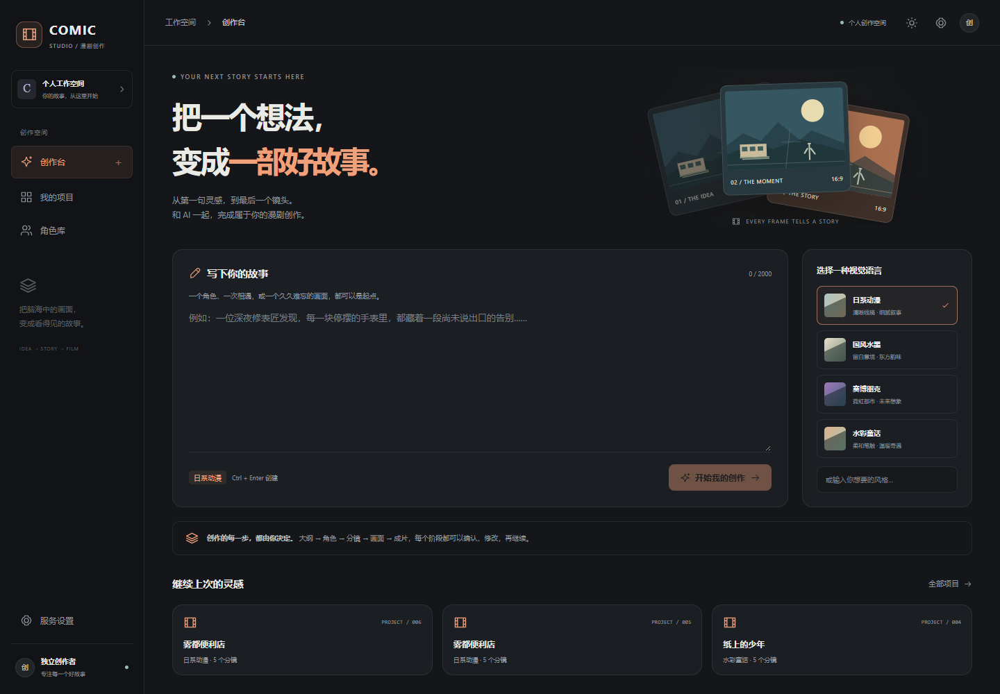

### 项目工作台

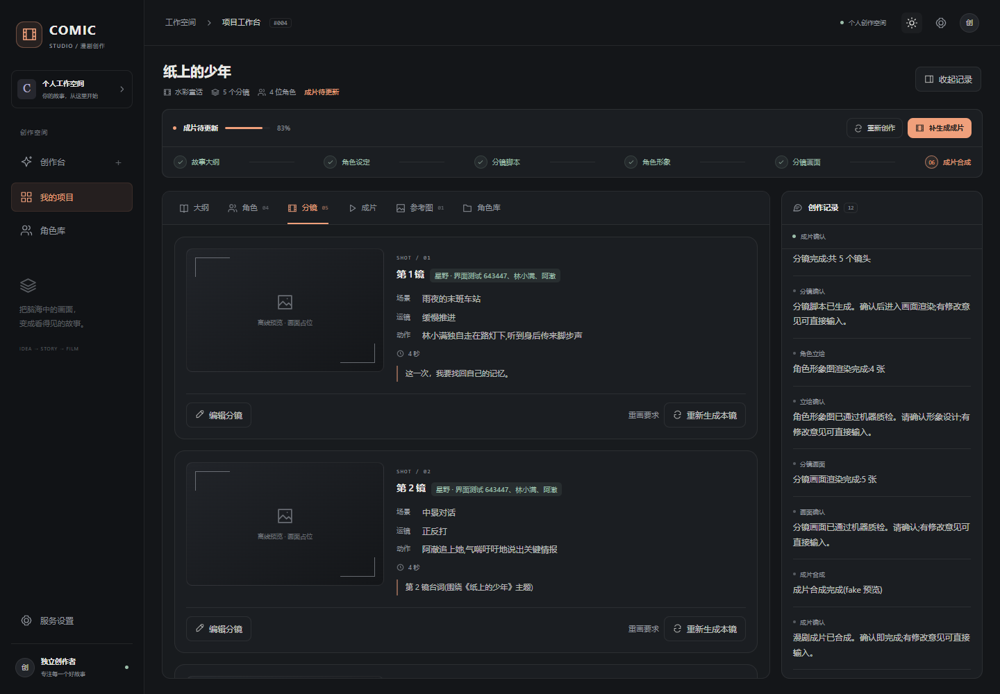

<details>
<summary>展开查看浅色主题、项目列表、角色库与移动端</summary>

#### 浅色主题

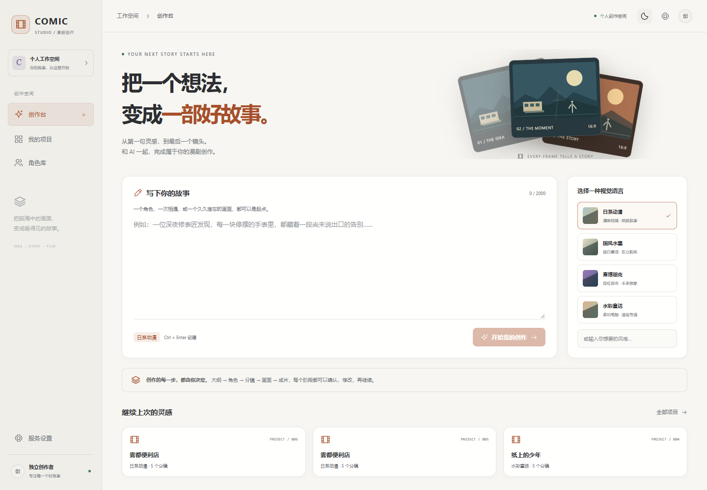

#### 项目列表

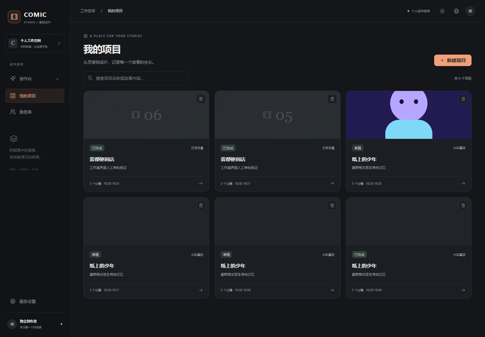

#### 角色库

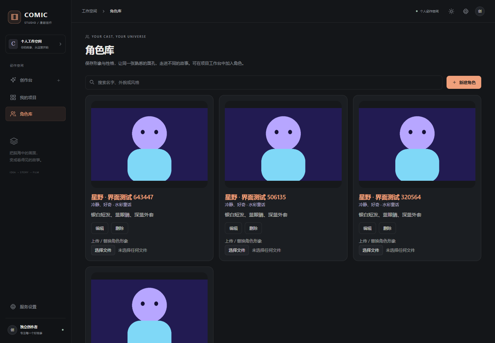

#### 移动端工作台

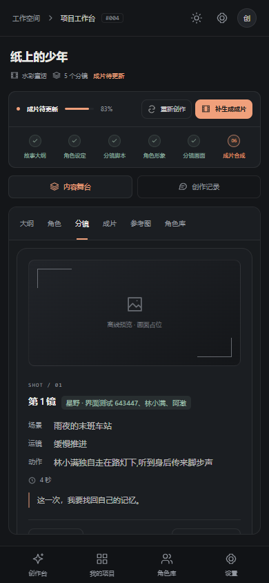

</details>

截图来自离线演示环境，示例角色与占位画面用于展示界面和操作流程，不代表真实模型的出图质量。

| 页面 / 区域 | 用途 |
| --- | --- |
| 创作台 `/#/` | 输入故事想法，选择风格，创建项目；支持 Ctrl / Cmd + Enter |
| 我的项目 `/#/projects` | 搜索项目、查看封面和状态、进入工作台或删除项目 |
| 工作台 `/#/project/{id}` | 审阅各类内容、编辑分镜、上传参考图、导入角色与确认阶段 |
| 角色库 `/#/characters` | 管理可跨项目复用的人物设定和形象 |
| 服务设置 `/#/settings` | 配置文本、图像、视频和配音服务 |
| 工作台“创作记录” | 查看生成消息与审批操作；桌面可收起，手机切换查看 |
| 顶栏太阳 / 月亮 | 切换并保存本机明暗主题偏好 |

注意：首页按钮会先**创建项目并进入工作台**，不会在创建动作里自动调用模型。进入工作台后点击“开始生成”，才会启动一轮管线。

<a id="stack"></a>
## 3. 技术栈与依赖管理

| 层级 | 技术 | 用途 |
| --- | --- | --- |
| 前端 | React 18、TypeScript、Vite、Tailwind CSS | SPA、内容工作区、主题与交互 |
| 路由 | React Router / HashRouter | `/#/` 路由，便于后端直接托管构建产物 |
| API | FastAPI、Uvicorn、Pydantic | HTTP 请求、参数校验、OpenAPI |
| 编排 | LangGraph `StateGraph` | 状态归并、条件路由、动态中断与恢复 |
| 持久化 | SQLModel、SQLAlchemy async、aiosqlite | 项目、运行记录、消息、配置与角色库 |
| Checkpoint | `langgraph-checkpoint-sqlite` | 图执行上下文持久化 |
| 外部请求 | httpx | 文本、图像、视频任务及 TTS 调用 |
| 图片处理 | Pillow | 上传校验、重编码、参考条合成 |
| 媒体处理 | FFmpeg、ffprobe | 视频拼接、探测真实时长与音轨合成 |
| 测试 | pytest、pytest-asyncio、Playwright 脚本 | 单元 / 集成测试与浏览器交互回归 |

后端依赖声明见 [pyproject.toml](pyproject.toml)，可复现版本见 [uv.lock](uv.lock)；前端对应 [package.json](frontend/package.json) 和 [package-lock.json](frontend/package-lock.json)。

优先使用锁文件安装。不要直接把某个项目的 `.venv` 复制到另一台电脑或另一个 Python 版本下使用；Pydantic、Pillow 等含原生扩展的依赖与解释器版本有关。

<a id="quickstart"></a>
## 4. 快速开始

### 4.1 环境要求

- Python **3.11 或更高版本**；Docker 镜像使用 Python 3.13。
- Node.js / npm；Docker 前端构建阶段使用 Node.js 22，本地可使用相同主版本。
- [uv](https://docs.astral.sh/uv/getting-started/installation/)：安装和同步后端锁定依赖。
- FFmpeg / ffprobe：仅真实视频拼接和配音合成需要；离线模式不要求调用它们。
- 外部服务凭据：仅接入真实 provider 时需要。

### 4.2 本地运行：构建前端，由 FastAPI 同源托管

以下命令都以项目根目录为起点。已有 `.env` 时保留自己的配置，不要覆盖。

**macOS / Linux / Git Bash：**

```bash
uv sync --frozen --no-install-project

# 仅首次创建本地配置
test -f .env || cp .env.example .env

cd frontend
npm ci
npm run build
cd ..

uv run --no-sync uvicorn app.main:app --host 127.0.0.1 --port 18766
```

**Windows PowerShell：**

```powershell
uv sync --frozen --no-install-project

if (-not (Test-Path .env)) {
    Copy-Item .env.example .env
}

Set-Location frontend
npm ci
npm run build
Set-Location ..

uv run --no-sync uvicorn app.main:app --host 127.0.0.1 --port 18766
```

启动后：

| 地址 | 内容 |
| --- | --- |
| `http://127.0.0.1:18766/` | 创作工作室 |
| `http://127.0.0.1:18766/docs` | Swagger API 文档 |
| `http://127.0.0.1:18766/redoc` | ReDoc API 文档 |
| `http://127.0.0.1:18766/health` | 基础存活检查，返回 `{"status":"ok"}` |

**先构建前端，再启动后端。** `create_app()` 只在初始化时检查 `frontend/dist` 是否存在；如果后端已启动时才首次生成 `dist`，需要重启后端，让根路径挂载生效。

### 4.3 前后端分别开发

终端一，在根目录启动后端：

```bash
uv run --no-sync uvicorn app.main:app --host 127.0.0.1 --port 18766
```

终端二：

```bash
cd frontend
npm ci
npm run dev -- --host 127.0.0.1
```

前端开发服务器默认端口是 `5173`，将 `/api`、`/static` 代理到 `127.0.0.1:18766`，配置见 [vite.config.ts](frontend/vite.config.ts)。前端页面开发可使用 Vite 热更新；修改 Python 代码后需要重新加载服务。调试在途任务时，注意自动重载会中断当前执行。

### 4.4 第一次体验

1. 使用默认 `fake` provider 打开创作台。
2. 输入主题，选择视觉风格，点击“开始我的创作”。
3. 可先上传风格参考图，或从角色库加入固定阵容。
4. 点击工作台“开始生成”。
5. 每个阶段检查产物，点击“通过”或填写修改意见。
6. 在“分镜”中编辑脚本或重画单个镜头。
7. 需要真实媒体产物时，再到“服务设置”切换并填写相应凭据。

使用 API 的 `auto_mode=true` 可以自动通过所有审批节点，适合测试和流程演示；前端常规生成使用人工确认模式。

<a id="architecture"></a>
## 5. 系统架构与模块职责

### 5.1 总体架构

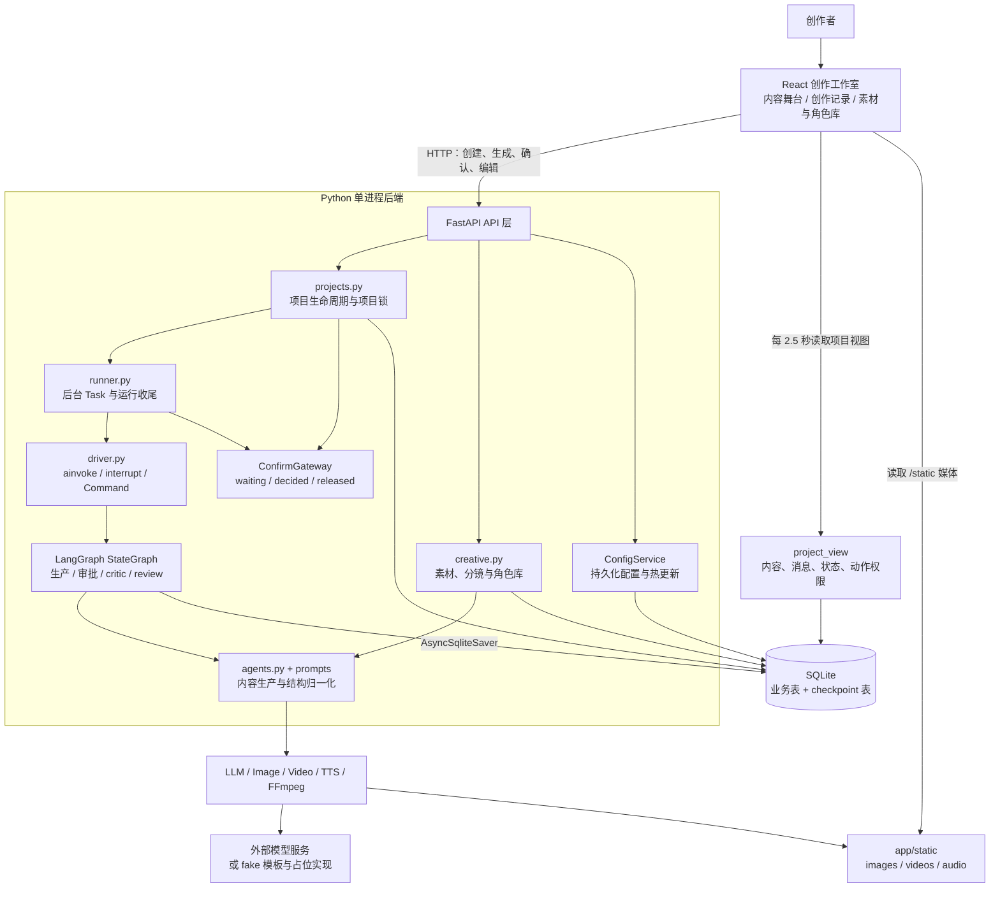

[查看可放大的系统架构图 SVG](docs/diagrams/architecture.svg)。

### 5.2 各层具体负责什么

| 模块 | 负责 | 不承担的职责 |
| --- | --- | --- |
| `api/projects.py` | 建项目、生成、确认、恢复、取消、删除；项目锁与后台任务注册 | 不自己写故事，不决定 LLM 提示词 |
| `api/creative.py` | 素材上传、分镜编辑、独立单镜重画、角色库 CRUD / 导入 / 保存 | 不把这些编辑自动转换成一次 LangGraph 回退 |
| `services/project_view.py` | 组装项目详情、最近运行、最近 50 条消息与按钮动作 | 不驱动图执行 |
| `runner.py` | 加载 run、编译图、注入审批策略、异常与取消收尾 | 不声明图拓扑 |
| `orchestration/driver.py` | 调用图，识别 `__interrupt__`，获得裁决后传入 `Command` | 不关心 HTTP、DB 按钮或某个模型厂商 |
| `orchestration/graph.py` | 注册 15 个节点和条件边 | 不直接调用外部 API |
| `orchestration/nodes.py` | 生产记账、动态审批、critic 循环、review 清理与回退 | 不包含完整厂商协议实现 |
| `agents.py` | 组装上下文、归一化 JSON、组织图像与视频生产 | 不保存 LangGraph checkpoint |
| `prompts/` | 各职责提示词与媒体提示词构造 | 不控制任务生命周期 |
| `services/llm.py`、`media.py`、`tts.py` | 请求构造、响应解析、下载和媒体客户端 | 不判断当前应该停在哪个审批门 |
| `gateway.py` | 在审批门的一次停留中传递确认信号 | 不持久化图状态，不跨进程通信 |

### 5.3 一次点击“开始生成”经过哪些层

```text
ProjectPage → api.generate(project_id)
    → POST /projects/{id}/generate
    → 配置预检 → 获取项目锁 → 检查最近 run
    → 创建 AgentRun → 项目标记 generating → commit
    → 锁内 asyncio.create_task(run_pipeline(run_id))
    → runner 注册 gateway，打开 SQLite checkpointer
    → build_phase2_graph().compile(checkpointer=...)
    → driver 调用 compiled.ainvoke(initial_state, graph_config)
    → 节点生成并保存产物 → 审批节点 interrupt
    → driver 收到 __interrupt__ → runner 等待 gateway
    → 前端轮询读取最新产物和确认入口
```

后台执行依托 Uvicorn 进程内的 `asyncio.Task`。HTTP 生成请求返回 `run_id`，不会等待整部作品完成，也不是 Celery / 独立队列 worker。

<a id="execution-graph"></a>
## 6. LangGraph 完整执行图

### 6.1 主流程、两组 critic 与反馈通道

下图对应 [graph.py](app/orchestration/graph.py) 的节点与边。`START`、`END` 和“视频是否就绪”是解释入口、出口与条件的标记，不计入 15 个注册节点。

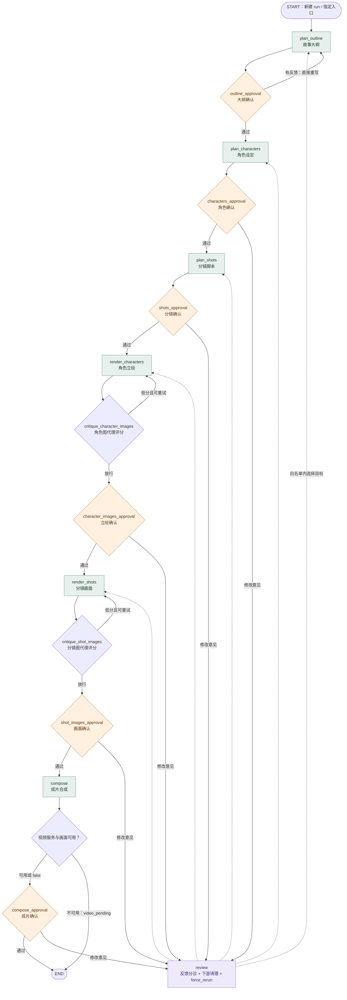

“放行”包含：评分达到阈值、关闭 critic、达到重试上限等情况。它不等价于“真实画面已由视觉模型验证合格”。

[查看可放大的 LangGraph 完整执行图 SVG](docs/diagrams/execution-graph.svg)。

### 6.2 15 个节点逐项说明

| 类别 | 节点名 | 输入依赖 | 主要输出 / 行为 |
| --- | --- | --- | --- |
| 生产 | `plan_outline` | `topic`、`style`、可选反馈 | `content.outline`，其中包含故事标题 |
| 审批 | `outline_approval` | 大纲 | 空反馈进入角色；非空反馈直接回大纲 |
| 生产 | `plan_characters` | 大纲、`cast`、可选反馈 | `content.characters` |
| 审批 | `characters_approval` | 角色表 | 通过进入分镜；反馈进入 review |
| 生产 | `plan_shots` | 大纲、角色外貌、可选反馈 | `content.shots`，含媒体提示词 |
| 审批 | `shots_approval` | 分镜脚本 | 通过进入立绘；反馈进入 review |
| 生产 | `render_characters` | 角色设定、库角色形象、参考图 | `content.character_images` |
| 评审 | `critique_character_images` | 角色说明与生成 prompt | 分数、轮数、重画 / 进入立绘确认 |
| 审批 | `character_images_approval` | 立绘候选 | 通过进入分镜图；反馈进入 review |
| 生产 | `render_shots` | 分镜、在场角色、立绘与上传参考 | `content.shot_images` |
| 评审 | `critique_shot_images` | 镜头说明与生成 prompt | 分数、轮数、重画 / 进入画面确认 |
| 审批 | `shot_images_approval` | 分镜画面 | 通过进入合成；反馈进入 review |
| 生产 | `compose` | 分镜图、视频配置、可选台词 | `content.video` 或 `video_pending` |
| 审批 | `compose_approval` | 成片 / fake 预览 | 通过结束；反馈进入 review |
| 分诊 | `review` | 当前门、反馈、项目摘要 | 回退目标、下游清理、`force_rerun` |

### 6.3 图入口、恢复入口和定点重入的区别

| 操作 | 是否新建 run | `ainvoke` 的初始 payload | 含义 |
| --- | --- | --- | --- |
| 正常生成 | 是 | 带 `current_stage=plan_outline` 的字典 | 从头创作 |
| 补合成 | 是 | 带 `current_stage=compose` 的字典 | 复用现有产物，只进入合成阶段 |
| 重渲全部分镜图 | 是 | 带 `current_stage=render_shots` 的字典 | 复用规划和立绘，再走图的后续节点 |
| 断点恢复 | 否 | `None`，使用原 `thread_id` | 加载同一 run 的 checkpoint 继续 |
| 审批后继续 | 否 | `Command(resume=feedback)` | 让当前动态 interrupt 得到裁决值 |
| 独立单镜重画 | 否 | 不调用图 | 直接调用创作编辑 API 中的定向渲染路径 |

图内部 `route_from_start()` 可读状态中的 `current_stage`；公开 `/generate` 接口只接受正常起步、`compose`、`render_shots` 三种入口，不开放任意跳阶段。

<a id="graph-state"></a>
## 7. State、产物与执行上下文

### 7.1 三种数据不要混在一起理解

| 数据 | 存放位置 | 作用 |
| --- | --- | --- |
| `ComicProject.content` | 业务表的 JSON 列 | 当前可供用户查看和继续编辑的产物 |
| `AgentRun` | 业务表 | 一轮执行的状态、阶段、进度、错误和自动模式 |
| `RunState` | LangGraph checkpoint | 图路由、执行历史、审批反馈与重跑控制 |

**产物主要在业务 JSON 中，图状态主要保存执行信息。** 节点通常通过 `project_id` / `run_id` 从 DB 读取项目，而不是把所有图片、视频或完整业务内容放进 `RunState`。

### 7.2 RunState 字段

定义见 [state.py](app/orchestration/state.py)。`TypedDict(total=False)` 允许恢复、定点入口和不同节点只提供必要字段。

| 字段 | 类型 / 语义 | 更新方式 |
| --- | --- | --- |
| `project_id`、`run_id` | 业务主键 | 初始写入 |
| `auto_mode` | 是否跳过人工等待 | 从 run 读取 |
| `current_stage` | 当前图节点 / 执行锚点 | 覆盖 |
| `next_stage` | 下一生产阶段提示 | 覆盖 |
| `route_stage` | 条件边的目标 | 覆盖 |
| `stage_history` | 已访问阶段列表 | `Annotated[list[str], add]` 累加 |
| `approval_history` | 审批 / review 轨迹 | `add` 累加 |
| `artifact_lineage` | 已完成生产阶段标记，如 `stage:plan_shots` | `add` 累加 |
| `approval_feedback` | 当前审批反馈 | 覆盖 |
| `review_requested` | 是否请求 review | 覆盖 |
| `force_rerun` | 本轮需要绕过 lineage 跳过的生产阶段 | 覆盖列表 |
| `critique_rounds` | 按资产类型记录重试轮次 | 整体更新字典 |
| `critique_scores` | 最近评分信息 | 覆盖 |
| `review_target_index` | review 识别的角色下标 | 仅角色立绘回炉使用 |
| `video_pending` | 本次合成阶段因前置条件不足而跳过 | 条件路由使用 |

Reducer 示例：

```python
from operator import add
from typing import Annotated, TypedDict

class RunState(TypedDict, total=False):
    stage_history: Annotated[list[str], add]
    artifact_lineage: Annotated[list[str], add]

# 节点返回增量，不需要复制整个历史：
return {
    "stage_history": ["plan_shots"],
    "artifact_lineage": ["stage:plan_shots"],
}
```

累加列表记录过程，不是去重集合。回炉后可能再次出现相同阶段名；生产跳过逻辑使用成员判断，而不是假设每个阶段只出现一次。

### 7.3 阶段幂等与显式重跑

`_produce()` 的关键判断：

```python
key = f"stage:{stage}"
lineage = state.get("artifact_lineage") or []
force = state.get("force_rerun") or []

if key in lineage and stage not in force:
    return {"current_stage": stage, "stage_history": [stage]}
```

- 普通恢复时，已完成阶段尽量复用，不重复调用生产者。
- 主动回炉时，即使 lineage 已有完成标记，也必须允许重新生产。
- 因此 review 和 critic 都需要显式设置 `force_rerun`；只把路由指回旧阶段，可能得到“绕了一圈但产物没变”的结果。

### 7.4 进度不是耗时预测

后端以六个生产阶段为坐标：

```text
progress = (生产阶段下标 + 阶段内进度) / 6
```

审批和 critic 映射到对应生产锚点。它不是按 token、API 任务耗时或每张图片动态预测的百分比。执行成功后 runner 写入 `progress=1.0`；前端对“已有产物但成片失效”的情况显示合成待更新状态。

<a id="human-review"></a>
## 8. 人工审批：interrupt 与确认网关

### 8.1 为什么把审批做成图中的节点

审批节点决定图是否前进，不能只是在前端弹出一个确认框。

`_approve()` 先把当前门与提示消息写入业务库，再执行：

```python
feedback = "" if auto_mode else interrupt({
    "gate": gate,
    "message": approval_message,
})
```

人工模式下，LangGraph 返回中断信息，driver 等待 runner 注入的 `on_interrupt` 回调。回调通过 `gateway.wait_confirm()` 等待用户。拿到裁决后，driver 再次调用图：

```python
payload = Command(resume=feedback)
result = await compiled_graph.ainvoke(payload, graph_config)
```

这是“中断返回给驱动器，再由外部输入恢复”的流程，不是简单地在节点里无限 `sleep`。当前使用的是 `ainvoke` 与 `__interrupt__`，没有接入 LangGraph 新版事件流 API。

框架会保存 interrupt 所在的图执行位置；恢复时中断节点可能从头重新执行，因此中断前的 DB 操作需要幂等。概念依据见 [LangGraph Interrupts](https://docs.langchain.com/oss/python/langgraph/interrupts)，本项目的具体去重策略见[幂等与恢复](#recovery)。

### 8.2 确认请求的完整时序

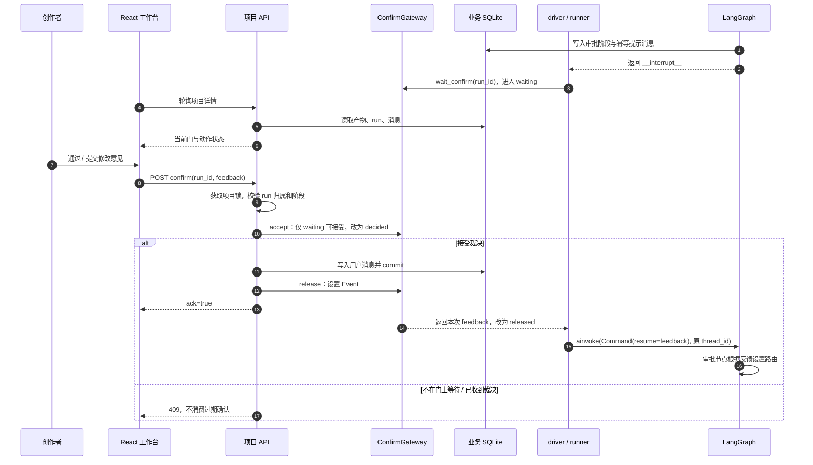

轮询项目详情使用 `GET /projects/{id}`，提交裁决使用 `POST /projects/{id}/confirm`。也可以[单独打开审批时序图 SVG](docs/diagrams/approval-sequence.svg)放大阅读。

### 8.3 ConfirmGateway 的状态机

```text
register
   ↓
released ── wait_confirm() ──▶ waiting
                                 │
                           accept(feedback)
                                 ↓
                              decided
                            /         \
                落库失败 abort()      落库成功 release()
                        ↓               ↓
                     waiting        Event.set()
                                        ↓
                              wait_confirm 消费反馈
                                        ↓
                                     released
```

要点：

1. `register()` 只注册本轮 run 的事件，初始不是 `waiting`。
2. 只有真正进入 `wait_confirm()` 后，`accept()` 才会返回成功。
3. `accept()` 先把状态从 `waiting` 改成 `decided`，第二个确认立即被拒绝。
4. 用户反馈消息 **commit 成功后** 才 `release()`，避免节点醒来时读不到反馈。
5. commit 失败会 `abort()`，把门恢复到等待状态。
6. runner 收尾时 `remove()` 清理事件、反馈和状态。

### 8.4 为什么只检查 `_approval` 后缀不够

业务行中 `current_stage` 的刷新与图推进之间存在很短的窗口：用户已经通过旧门，run 正进入 review / 下一生产节点，但 DB 阶段名可能暂时仍是旧门。

只看阶段名就接收确认，可能让“旧界面的第二次点击”成为下一道门的裁决。这里叠加三层防护：

- 后端确认接口检查 run 存在、归属正确、状态是 `running`、阶段是审批门。
- 网关只接受这次实际停留中的 `waiting` 状态。
- 前端记录已确认的 run / gate；在观察到离开该门之前禁用重复提交。

`project_view` 中的 `waiting_gate` 根据业务阶段推导，适合展示；网关的等待状态才是确认是否可接受的最终依据。界面短暂显示确认入口但接口返回 409，并不必然意味着流程异常。

### 8.5 等待有超时

LangGraph 的 interrupt 本身支持持久化等待；本应用额外设置 `CONFIRM_TIMEOUT_S`，默认 **1800 秒**。超过时限会走 runner 异常收尾，run 标记 `failed`。当前 API 的 `/resume` 面向 `interrupted`，不会把所有 `failed` run 自动恢复。

<a id="rollback"></a>
## 9. 反馈回退：分诊、护栏与下游失效

### 9.1 回退处理的总体步骤

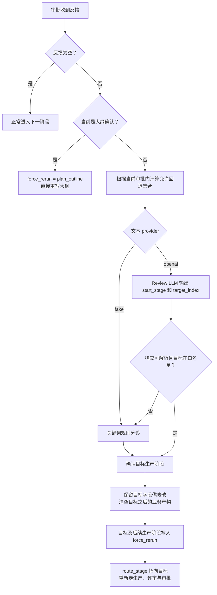

review 输出的是**受代码约束的业务修改目标**，不是任意函数名、任意节点执行命令或数据库回滚指令。

### 9.2 分诊输入与输出

LLM 收到的信息包括：

- 用户的自然语言反馈。
- 当前大纲标题与梗概。
- 最多 8 个角色的名字 / 下标。
- 当前分镜数量、角色图数量、分镜图数量。
- 是否已有成片。

期望输出类似：

```json
{
  "start_stage": "render_characters",
  "target_index": 1
}
```

`start_stage` 必须通过当前门的白名单；`target_index` 仅在 `render_characters` 目标下使用，且必须位于当前角色表范围。非法下标退化为不带角色下标的路径。LLM 输出无法解析或目标非法时，降级到规则分诊。

### 9.3 可回退范围：不能跳到尚未生产的未来

```text
允许回退集合 = 常规回退白名单 ∩ 当前生产锚点及之前的阶段

常规回退白名单 = {
  plan_outline,
  plan_characters,
  plan_shots,
  render_characters,
  render_shots
}
```

| 当前审批门 | 可回退的生产阶段 |
| --- | --- |
| `outline_approval` | 特殊处理：直接 `plan_outline` |
| `characters_approval` | `plan_outline`、`plan_characters` |
| `shots_approval` | 上述阶段 + `plan_shots` |
| `character_images_approval` | 上述阶段 + `render_characters` |
| `shot_images_approval` | 上述阶段 + `render_shots` |
| `compose_approval` | 全部五个常规回退阶段，不包含 `compose` |

例如：在角色确认阶段说“主角的立绘需要改发色”，不能直接跳到 `render_characters`，因为分镜还没有产生。即使模型提出这一目标，也会被白名单拦截，再由规则选择可执行阶段。

`compose` 不在 review 的回退目标中。只想改视频模型、画幅或合成参数时，使用“重新合成成片” / `start_stage=compose`。

### 9.4 规则分诊顺序

见 `agents._RERUN_KEYWORDS`。具体词在泛化词之前匹配：

| 优先级 | 关键词示例 | 目标 |
| --- | --- | --- |
| 1 | 角色图、形象图、立绘、脸崩、脸歪 | `render_characters` |
| 2 | 分镜图、画面 | `render_shots` |
| 3 | 大纲、故事、情节、世界观、主题、结局 | `plan_outline` |
| 4 | 角色、人物、性格 | `plan_characters` |
| 5 | 分镜、镜头、节奏、台词 | `plan_shots` |
| 兜底 | 未命中或命中阶段不允许 | 优先 `plan_characters`，否则 `plan_outline` |

匹配同时检查目标在允许集合内。“角色图”先于“角色”，可避免把画面问题误分诊成角色文本重写。规则是可解释的兜底，不等于完整自然语言理解。

### 9.5 回退后的数据清理矩阵

实现以 `_STAGE_FIELD_ORDER` 为依赖顺序。**目标自己的字段先保留，供生产者读取现有内容做修改；目标之后的字段清空。** 目标及其后续生产阶段放入 `force_rerun`。

| 回退目标 | 暂时保留并由目标重写 | 保留的上游 | 清空的下游 |
| --- | --- | --- | --- |
| `plan_outline` | `outline` | 无常规上游产物 | `characters`、`shots`、`character_images`、`shot_images`、`video` |
| `plan_characters` | `characters` | `outline` | `shots`、`character_images`、`shot_images`、`video` |
| `plan_shots` | `shots` | `outline`、`characters` | `character_images`、`shot_images`、`video` |
| `render_characters` | `character_images` | `outline`、`characters`、`shots` | `shot_images`、`video` |
| `render_shots` | `shot_images` | 所有规划内容与 `character_images` | `video` |

这里是**保守的线性依赖清理**。例如回退 `plan_shots` 目前也会使角色图失效，即使角色设定文本本身未改；它还不是按精细资产依赖图计算的最小增量构建系统。

`reference_images`、`cast` 不在上述常规产物序列中，review 不清空这两项。清空通常写入 `None`，视频写入空对象 `{}`，并不等于立刻删除磁盘上的所有旧文件。

### 9.6 为什么 force_rerun 必须覆盖下游

假设某个 run 已经合成过视频，这时从 `compose_approval` 回退到 `render_shots`：

```text
原 lineage：已含 render_shots、compose
review：清空 video

如果只回到 render_shots，但不强制 compose：
  → render_shots 更新了
  → compose 看到已有完成标记而跳过
  → video 仍然为空
```

因此 `review_node()` 取目标在六生产阶段序列中的位置，设置目标到序列末尾的 `force_rerun`。这使“下游已经失效”和“下游必须重新执行”保持一致。

### 9.7 定向修改到底保证到什么程度

| 场景 | 代码如何处理 | 实际保证 |
| --- | --- | --- |
| 独立单镜重画接口 | `shot_indices={index}`，其他镜头直接复用原资产对象 | 不调用其他镜头的生图生产 |
| 真实分镜图反馈，目标是 `render_shots` | 提取 `第N镜` / `分镜N`，对其他已有图片复用 | 在资产存在且非全局重写时减少重画 |
| 真实角色图反馈 | 优先使用 review 的角色下标，再用名字匹配 | 未点名且已有旧图的角色可复用 |
| 真实分镜脚本反馈 | LLM 输出新镜头后按 `index` 合并，未点名镜头保留原对象 | 未点名分镜可由代码保持原文 |
| 大纲与普通角色文本 | 把现有设定与反馈放入上下文后，要求模型定向修改 | 主要依赖提示词，尚无通用字段级补丁约束 |
| 固定 `cast` | 按库角色名单合并，排除模型输出的同名替代项 | 固定阵容优先，但不是历史版本系统 |

另外，review 可能已清空某些下游字段，之后渲染器就没有旧图可复用。不能把“点名修改”宣传成在任意回退层级下都只付出一个镜头的成本。

镜头点名使用数字正则，建议明确写 `第2镜`、`分镜2`；`第二镜` 等中文数字形式不在当前提取规则内。包含“全部 / 所有 / 整体 / 通篇 / 重写 / 重排 / 重新分镜”等词时，可能进入全局重写路径。

生产节点给 producer 注入的反馈，来自本 run 最近一条非空、非“通过”的用户消息，并截取前 400 字符；review 路由使用的是审批状态中的反馈。长篇修改需求不等于所有内容都会原样进入每个生产阶段，明确而简短的点名更可控。

### 9.8 具体示例

**示例 A：只改变第 3 镜的画面。**

```text
当前：shot_images_approval
反馈：“第3镜的画面改为雨夜，保持人物位置。”

review → render_shots
保留：大纲、角色、分镜、立绘、旧分镜图
清空：video
强制：render_shots、compose
结果：第3镜使用反馈，其他有图镜头复用 → critic → 画面确认 → 合成 → 成片确认
```

**示例 B：人物性格改变，影响后续剧情。**

```text
当前：任一允许回退角色设定的审批门
反馈：“角色性格改成谨慎克制，并让冲突来自误会。”

review → plan_characters（以实际 LLM / 规则结果为准）
保留：outline、原 characters 作为修改上下文
清空：shots、character_images、shot_images、video
之后重新走角色确认、分镜确认、立绘和画面生产
```

**示例 C：只是换视频画幅。**

```text
在设置中修改画幅 → 等当前 run 收尾 → 重新合成成片
新 run 从 compose 起步，不使用 review，也不重新写故事或重画图片
```

<a id="critique"></a>
## 10. 质检闭环与重试上限

### 10.1 两组相互独立的闭环

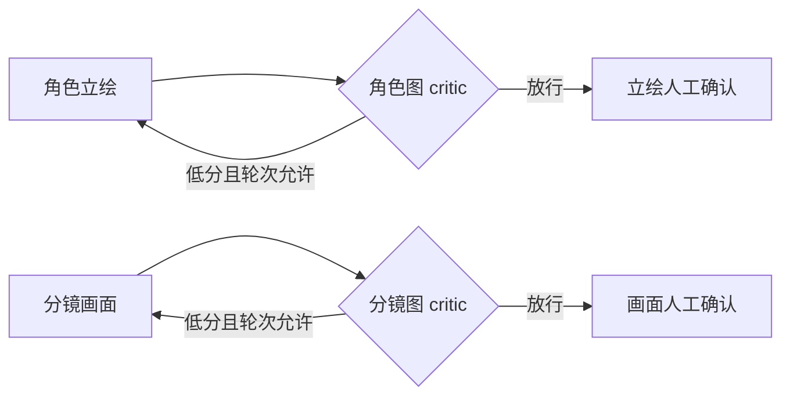

轮次键分别是 `character_images` 和 `shot_images`；角色图消耗的重试预算不会直接扣到分镜图。

### 10.2 评分依据和公式

当前 `assess_images()` 的真实文本模型路径会整理最多 6 个资产的**文字说明与生成 prompt**，让文本模型输出维度分：

```text
consistency：与角色 / 镜头文字设定的一致性
quality：提示词所描述的质量要求
composition：提示词的构图合理性

score = round(0.4 × consistency + 0.3 × quality + 0.3 × composition, 1)
```

维度被限制在 0–10。服务返回的总分不是唯一依据，代码会重新按维度计算。默认通过阈值为 `6.0`。

**当前没有把真实图片像素作为视觉输入提交给 critic。** 因此这是一种提示词 / 描述的代理评估，不能可靠识别实际脸部畸变、手指数量、图中文字错误或画面构图偏差。fake 路径默认按规则返回 8.5；`CRITIQUE_FORCE_FAIL=1` 可强制给低分演示回炉。

### 10.3 轮数上限如何生效

默认 `CRITIQUE_MAX_ROUNDS=2`：

```text
第一次渲染 → 第一次评分
    达标：人工确认
    低分且尚有额度：强制重渲
第二次渲染 → 第二次评分
    达标：人工确认
    仍低分：记录达到上限，放行到人工确认
```

关闭 critic、轮数已达到上限时也会进入审批门。人工仍需审查候选。“达到上限后放行”是成本 / 流程策略，不意味着画面已经合格。

### 10.4 与独立单镜重画的边界

图内的 `render_* → critic → approval` 会走上述闭环；创作 API 的独立单镜重画直接调用 `render_shot_images(..., shot_indices={...})` 并提交业务结果，**不会创建一个图 run，也不会重新进入这组 critic 节点**。它依赖用户检查画面和后续审批 / 合成操作。若要让每次独立重画也经过同一评分策略，可在创作服务中抽出并复用评审流程。

<a id="editing"></a>
## 11. 三种修改方式与编辑一致性

### 11.1 选择合适的操作

| 你想做的事 | 建议操作 | 执行方式 |
| --- | --- | --- |
| 改剧情、角色关系或整体叙事 | 审批门提交修改意见 | review 分诊，图内回退与下游重建 |
| 明确知道要改哪一镜的脚本 | “编辑分镜”后保存 | 业务 JSON 更新与旧产物失效 |
| 只想换一张画面 | “重新生成本镜” | 独立单镜渲染接口 |
| 修改画幅 / 视频参数 | “重新合成成片” | 新 run 从 `compose` 起步 |
| 服务重启导致任务中断 | “恢复续跑” | 原 run / 原 thread 从 checkpoint 恢复 |
| 新做一个版本的全部内容 | “重新创作” | 新 run，常规产物重置，保留参考图和 cast |

### 11.2 编辑分镜的失效规则

`PUT /projects/{id}/shots/{shot_index}` 保存完整可编辑字段，不是任意 JSON Patch：

- `scene`、`camera`、`action`、`character_ids`、`image_prompt` 变化会让该镜画面标记 `stale=true`。
- 画面描述改变但旧 `image_prompt` 未改时，清掉旧媒体提示词，让后续生成重新构造。
- 对白变化时，未显式修改的旧 `video_prompt` 也会失效。
- 编辑会清空旧 `video`，设置 `video_dirty=true`。
- 已完成项目在成片失效后回到 `draft`；最近的成功 run 仍保留历史结果状态，两者并不矛盾。
- 原图片 URL 暂时保留，便于对照，但 UI 会提示它需要更新。

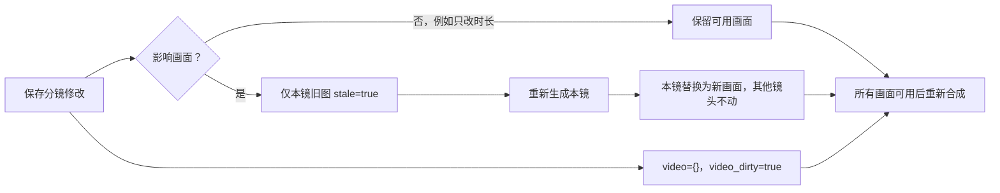

`shot_images_approval` 的无反馈通过请求会检查所有镜头是否有非 stale 画面；`start_stage=compose` 也检查已有脚本对应画面是否齐全。因此不能编辑完脚本后直接拿旧画面进入合成。

### 11.3 参数约束

| 字段 | 当前约束 |
| --- | --- |
| `scene` | 最多 2000 字符 |
| `camera` | 最多 1000 字符 |
| `action`、`dialogue` | 分别最多 4000 字符 |
| `duration` | 有限数值，`0 < duration <= 60` |
| `character_ids` | 最多 30 项，每项必须落在当前角色表中 |
| `image_prompt`、`video_prompt` | 分别最多 4000 字符，可留空触发构造兜底 |

脚本 `duration` 并不强制决定 Ark 最终视频段长；真实视频请求使用视频服务配置，配音对齐优先探测实际生成片段的时长。

### 11.4 哪些时刻允许编辑

| 运行状态 / 停留点 | 分镜编辑与单镜重画 | 角色导入 | 参考图管理 |
| --- | --- | --- | --- |
| 没有 run，或最近 run 已成功 / 失败 / 取消 | 允许，需已有对应产物 | 允许 | 允许 |
| 大纲确认 | 不允许 | 允许 | 允许 |
| 角色确认 | 不允许 | 允许 | 允许 |
| 分镜确认 | 允许 | 不允许 | 允许 |
| 立绘确认 | 不允许 | 不允许 | 允许 |
| 画面确认 | 允许 | 不允许 | 允许 |
| 成片确认 | 不允许 | 不允许 | 不允许 |
| 正在执行生产 / review / critic | 不允许 | 不允许 | 不允许 |
| `interrupted` 待恢复 | 不允许 | 不允许 | 不允许 |

审批点还必须满足网关实际处于 `waiting`，不是只凭节点名判断。

### 11.5 并发时如何避免踩数据

生成、恢复、确认、编辑、重画和项目删除共用 `_project_lock(project_id)`。例如单镜重画持锁期间，确认请求会等待；重画结果提交后，确认再检查最新画面是否可用。

独立单镜重画目前是**等待渲染完成才返回的 HTTP 请求**。浏览器显示忙碌状态；它不是独立可恢复的后台 job。请求超时 / 中断、服务重启后的细粒度恢复，仍属于后续可以扩展的方向。

<a id="assets"></a>
## 12. 参考图与角色库

### 12.1 参考图保存与校验

上传接口接受原始图片字节，不是 multipart 表单：

```text
POST /api/v1/projects/{id}/references?kind=style
Content-Type: image/png
Body: <图片二进制>
```

| 项目 | 规则 |
| --- | --- |
| 格式 | 实际解码验证 PNG / JPEG / WebP，不只相信扩展名 |
| 文件大小 | 上传流累计最多 8 MiB，超出返回 413 |
| 像素数量 | 不超过 2000 万像素 |
| 处理 | 修正 EXIF 方向、转换 RGBA、最长边缩至不超过 1400、重编码 PNG |
| 数量 | 每项目最多 20 张参考图 |
| 文件名 | 服务端生成标识，不使用上传路径作为磁盘路径 |
| 位置 | `app/static/images/`，业务 JSON 保存本地 URL |

用途：

- `kind=style`：整体风格，无 `target_index`。
- `kind=character`：目标是角色数组的 **0 起始下标**；保存时也记录 `target_name`，匹配时优先按名字，减少角色排列变化带来的误关联。
- `kind=shot`：目标是分镜的实际 `index`，例如第 3 镜传 `target_index=3`。

### 12.2 分镜渲染的参考图优先级

```text
当前镜头上传参考图
    → 当前镜头在场角色的上传参考图
    → 项目整体风格参考图
    → 在场角色已有的立绘
    → URL 去重
    → 取前 3 张作为图片参考
```

优先级由 `render_shot_images()` 控制。额外角色的外貌仍可进入文本上下文，但不能保证每位角色都拥有独立的像素参考输入。

角色立绘渲染使用该角色上传参考与整体风格参考；从库导入且已带固定形象的角色，在普通无反馈立绘生产时直接复用该形象。

真实生图存在上传参考而未配置 `IMAGE_CONSISTENCY_MODEL` 时会给出可操作错误，避免“看起来上传成功，但参考图悄悄没用”。普通立绘身份参考没有启用一致性模型时，则可走原纯文字路径。

当前 `Qwen-Image-Edit-2509` 接线使用 `image`、`image2`、`image3` 独立字段；其他编辑模型的接线可能使用合成参考条。**这是本项目适配层的实现，不表示任意模型都兼容这些字段。**

### 12.3 角色库与项目 cast 的区别

| 概念 | 位置 | 生命周期 |
| --- | --- | --- |
| 库角色 | `LibraryCharacter` 独立业务表 | 可跨项目保存和编辑 |
| 固定阵容 `cast` | 项目 `content.cast` | 导入时建立的项目内快照 |
| 当前角色 `characters` | 项目 `content.characters` | 本轮创作使用的完整人物表 |
| 角色立绘 `character_images` | 项目 JSON + 媒体文件 | 供分镜参考和审阅使用 |

导入时：

1. 校验项目编辑权限和同名角色冲突。
2. 拷贝名字、性格、外貌、特征。
3. 将库图片复制为项目自己的本地文件。
4. 写入 `cast`，并加入当前 `characters`。
5. 有图片时同时写入项目立绘引用。
6. 后续 `produce_characters()` 优先合并 cast，避免同名角色被模型替换。

“存入角色库”同样复制图片，而不是让库角色依赖来源项目文件。删除库角色不会删除已导入项目的形象；删除来源项目也不会破坏库里独立保存的图片。

导入后的角色是快照：之后编辑库角色不会自动修改所有项目中的同名角色。当前也没有角色版本号、绑定同步、去重合并或一键替换项目角色的能力。

<a id="recovery"></a>
## 13. 断点恢复、幂等与执行状态

### 13.1 run 与 checkpoint 的关联

```python
thread_id = f"agent-run-{run_id}"
graph_config = {"configurable": {"thread_id": thread_id}}

async with open_checkpointer(settings.database_url) as saver:
    compiled = build_phase2_graph().compile(checkpointer=saver)
```

同一个 run 恢复时必须使用同一 `thread_id`。新建一轮 run 会产生新的图线程；不能只沿用项目 ID 就假设这是同一次执行。

Checkpoint 和业务表使用同一个 SQLite 文件，但由不同连接 / 事务管理。框架概念参考 [LangGraph Persistence](https://docs.langchain.com/oss/python/langgraph/persistence)，本项目仅实现 SQLite checkpointer。

### 13.2 运行状态机

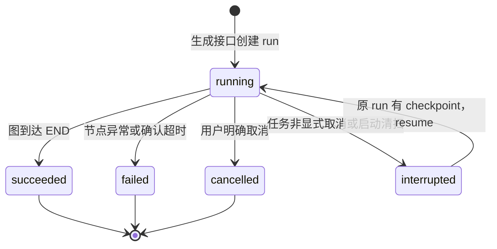

`queued` 是模型中可识别、并发检查也会阻止重复生成的状态；当前正常生成接口直接创建 `running`。

| 情况 | run 状态 | project 状态 | 下一步 |
| --- | --- | --- | --- |
| 正常结束 | `succeeded` | `succeeded` | 审阅或新一轮生成 |
| 视频前置条件不足，跳过合成 | `succeeded` 且 `video_pending=true` | `succeeded` | 完善配置后补成片 |
| 生产失败 / 等待超时 | `failed` | `failed` | 查看原因；合适时定点补片或新一轮生成 |
| 用户停止 | `cancelled` | `draft` | 当前 API 不把取消任务作为可续跑任务 |
| 服务中断 | `interrupted` | `interrupted` | 有 checkpoint 时恢复原 run |
| 成片因编辑失效 | 最近 run 保留原状态 | 可能回到 `draft` | 重画缺失 / stale 镜头后补合成 |

### 13.3 服务重新启动后做什么

`init_db()` 顺序包括：

1. 创建缺失的业务表。
2. 尝试补充旧库所需的轻量列迁移，如 `message.superstep`。
3. 把遗留 `running` run 标为 `interrupted`，项目同步中断状态。
4. 初始化配置种子，再回灌 DB 中保存的运营配置。

重启不会自动重开所有任务。用户点击“恢复续跑”后，接口检查原 run 和 checkpoint，再以 `initial_payload=None` 调图。如果仍停在审批中断处，工作台会再次等待该门的确认。

如果进程在第一个 checkpoint 建立前就退出，`resume` 无有效断点；接口引导重新生成，不把项目永久困在恢复按钮里。

### 13.4 幂等分为几个层次

| 层次 | 当前处理 |
| --- | --- |
| 任务入口 | 项目锁 + 最近 run 状态检查，防同项目两条执行互踩 |
| 审批提示消息 | 按同 run / 同审批门查询后插入，避免 interrupt 重放重复提示 |
| 生产 / critic / review 消息 | 查询 `run_id + agent + role + content + superstep` 再插入 |
| 完成生产阶段 | `artifact_lineage` 成员判断，主动返工需 `force_rerun` |
| 用户确认 | 网关 `waiting → decided → released`，防重复裁决 |

`superstep` 取当前 `stage_history` 长度，用于区分“同一次执行的重放”和“合法回炉后再次执行”。相同内容在新的阶段历史位置上可以生成新的记录。

审批提示当前按 run / gate 去重，回到同一审批门时通常复用原有提示行；前端通过阶段离开 / 再进入的观察重新开启确认，而非依赖每次新增一条审批提示。

### 13.5 Checkpoint 不等于外部调用 exactly-once

这是持久化工作流最容易被误读的部分：

- 外部模型调用、媒体文件落盘、业务 DB 提交、checkpoint 写入并不是一个跨系统事务。
- 如果远程生图已成功，但进程在记录完成之前崩溃，恢复后仍可能再次调用模型。
- 如果文件已经落盘但业务引用尚未保存，可能留下孤立文件。
- 当前 Ark 远程任务 ID 没有独立的持久任务台账；进程中途退出可能无法继续轮询同一个已提交远程任务。
- 因此这里提供的是**阶段恢复与应用层去重策略**，没有实现外部付费 API 的严格恰好执行一次保证。

要进一步降低重复计费，需要为每个资产生产建立持久 job、请求幂等键、厂商任务 ID、结果缓存和提交状态；仅增加一个 checkpointer 还不够。

<a id="providers"></a>
## 14. 文本、图像、视频与配音链路

### 14.1 fake 与真实服务分开在哪一层

图节点调用统一的 producer；producer 内部根据设置选择模板或真实服务。切换 provider 不需要改图拓扑。

| 内容 | fake | 真实路径 |
| --- | --- | --- |
| 大纲 / 角色 / 分镜 | 确定性模板 | OpenAI 兼容 Chat Completions |
| 角色 / 分镜图片 | `fake://...` URL | SiliconFlow 生图或参考图编辑 |
| 视频 | `fake://video/preview.mp4` | Ark 异步图生视频 + FFmpeg |
| 配音 | 不发送真实请求 | SiliconFlow TTS，满足条件才启用 |

fake 验证的是业务流程、数据流与交互，不用于证明真实模型的叙事、身份一致性或媒体质量。fake 分镜模板也不是对任意修改意见的语义理解实现。

### 14.2 文本模型：结构化内容生产

请求由 `LLMClient.chat_json()` 发送至：

```text
POST {TEXT_BASE_URL}/chat/completions
messages = system prompt + user context
temperature / max_tokens / optional thinking
```

解析流程包括：

1. 检查网络错误和 HTTP 状态，包装为 `LLMOutputError`。
2. 检查服务响应 JSON 与 `choices[0].message.content`。
3. 容忍代码围栏等常见模型包裹格式，提取顶层 JSON 对象。
4. 使用阶段归一化函数校验关键结构、裁剪不合适字段 / 长度。
5. 把可读 `user_message` 作为阶段摘要；缺失时使用本地兜底摘要。

`TEXT_THINKING=disabled|enabled` 会传项目适配的 `thinking` 字段；`auto` 不传。不同 OpenAI 兼容服务对该扩展字段的支持不同，迁移模型时需要核对。

提示词分为大纲、角色、分镜、review、critic 和图像提示词模块。分镜中 `image_prompt` / `video_prompt` 有作者模型生成路径，也有根据脚本字段构造的兜底路径。

### 14.3 图像链路

```text
角色 / 分镜结构
  → 选择提示词：已有媒体 prompt 或构造兜底
  → 选择参考图与一致性模型
  → ImageGenClient.generate()
  → 解析图片 URL 或 base64
  → 下载 / 存储为本地文件
  → content 中记录 /static URL 和实际 prompt
```

当前适配层：`POST {IMAGE_BASE_URL}/images/generations`，使用 `image_size`，响应兼容已有实现中的 `images` / `data` 结构。没有假设所有服务都接受完全相同的模型参数。

远程图片链接可能有时效，本项目把结果转成本地文件引用。部分角色图文字生成失败会按预设措辞变体重试；这不是对所有网络 / 模型错误的通用重试框架。

### 14.4 视频与音轨链路

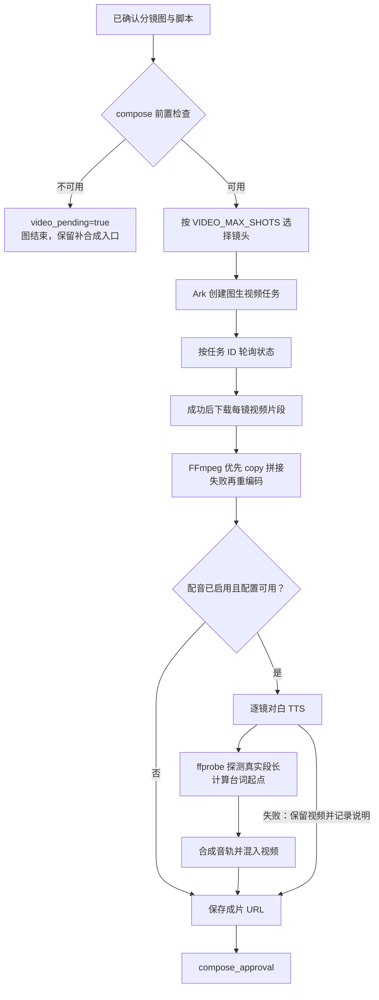

Ark 客户端主要步骤：

- `POST /contents/generations/tasks` 创建任务。
- 图像作为 `first_frame`；默认内联本地图片为 data URL，配置公开地址后可传完整 URL。
- 默认每 5 秒轮询一次，任务轮询总时限 600 秒。
- 返回成功后下载视频，再处理下一镜；当前生产循环按镜顺序执行，没有实现并行镜头队列。

`PUBLIC_BASE_URL` 如果指向 `localhost`，外部视频服务无法把它当成你电脑的可访问公网地址。使用外链模式时应提供服务端实际能访问的地址；未配置时保留 data URL 路径。

### 14.5 视频可跳过，为什么 run 仍成功

真实视频服务未配齐、或分镜仍是 fake / 非本地引用时，`compose_blocked_reason()` 给出原因。节点设置 `video_pending=true`，`route_after_compose()` 直接到 `END`，不会让用户面对一个不存在的成片审批。

runner 的 `succeeded` 表示这次图执行按策略结束，不等于所有模态都已真实生成。读取结果时同时检查 `video_pending`、`content.video` 与 `actions.video_blocker`。

真正发起远程任务后发生服务错误、下载失败、FFmpeg 失败等，则通常进入 `failed`，与“前置条件不足而主动跳过”不同。

### 14.6 配音的时间轴与降级

- 复用 SiliconFlow 图像服务地址和密钥。
- 每镜有非空对白才生成音频。
- 当前语音请求显式使用 44100 采样率，音色按 `model:voice` 拼接。
- MOSS 路径把单句包成 `[S1]`；当前不是按角色自动分配多音色的对白导演系统。
- 使用真实视频片段时长累加音频起点，探测失败时回退脚本时长。
- 音轨合成通过延迟和混音对齐，总长限制到视频时间轴。
- 不用 `-shortest` 把短音轨造成的视频截短当成正常结果。
- 未启用、缺配置或无对白时跳过；处理异常不会报废已经生成的视频画面。

长句音频如果超过对应镜头时长，当前不具备自动改写台词、拉长镜头、唇形同步或多角色音色编排能力。

<a id="configuration"></a>
## 15. 配置优先级与完整参数说明

### 15.1 两阶段的配置优先级

启动时，`get_settings()` 从环境和 `.env` 构造 Settings；随后 `init_db()` 初始化 / 回灌配置：

```text
第一次使用某个数据库：
  Settings 默认值 ← .env ← 进程环境变量
                           ↓
                  ConfigService.ensure_initialized()
                           ↓
                   缺失的运营配置项写入 DB

之后使用同一个数据库：
  先构造 Settings → 读取 DB 中已保存的运营配置 → 覆盖到进程内单例

运行中保存配置：
  字段白名单 → 合并并整体校验 → DB commit → 原地更新 Settings
```

这意味着：

- 对已经写进 DB 的运营配置，**DB / 设置页值会覆盖启动时的环境值**。
- 只改 `.env` 不一定能改变一个已初始化项目的模型服务商。
- 数据库地址、运行环境、审批超时等不在运营配置白名单中的项目，仍在启动时读取。
- 创建全新的独立测试库时，环境变量才能作为那份库的首次种子。
- 热更新使用同一个 Settings 单例原地赋值，现有客户端读取配置时能看到新值；这不是为在途 run 冻结配置快照。生成中切换 provider 可能让不同阶段使用不同设置。

### 15.2 基础与执行参数

默认值以 [config.py](app/config.py) 为准；表中的“空”表示 `None`。示例 `.env` 会额外把 `TEXT_THINKING` 设为 `disabled`。

| 环境变量 | 默认值 | 设置入口 / 说明 |
| --- | --- | --- |
| `APP_NAME` | `comic-agent` | 启动环境；应用名称 / 部分请求标识 |
| `ENVIRONMENT` | `dev` | 启动环境；`prod` 关闭通用异常响应中的调试 details |
| `DATABASE_URL` | `sqlite+aiosqlite:///./comic-agent.db` | 启动环境；业务库与 checkpoint 共用 |
| `API_V1_PREFIX` | `/api/v1` | 声明中的保留字段；当前聚合路由仍固定 `/api/v1`，不能只靠改环境切换路径 |
| `CONFIRM_TIMEOUT_S` | `1800.0` | 启动环境；单次人工确认等待时限 |
| `PUBLIC_BASE_URL` | 空 | 配置 API；需要用公网 URL 向视频服务提供图片时使用 |

### 15.3 文本生成

| 环境变量 | 默认值 | 设置入口 / 说明 |
| --- | --- | --- |
| `TEXT_PROVIDER` | `fake` | UI / 配置 API；`fake` 或 `openai` |
| `TEXT_BASE_URL` | 空 | UI / 配置 API；兼容服务 base URL，客户端追加 `/chat/completions` |
| `TEXT_API_KEY` | 空 | UI / 配置 API；敏感字段 |
| `TEXT_MODEL` | 空 | UI / 配置 API；界面预设模型或 API 指定模型 |
| `TEXT_THINKING` | `auto` | 配置 API / 首次环境种子；`auto`、`disabled`、`enabled` |

### 15.4 图像与参考编辑

| 环境变量 | 默认值 | 设置入口 / 说明 |
| --- | --- | --- |
| `IMAGE_PROVIDER` | `fake` | UI / 配置 API；`fake` 或 `siliconflow` |
| `IMAGE_BASE_URL` | 空 | UI / 配置 API；客户端追加 `/images/generations` |
| `IMAGE_API_KEY` | 空 | UI / 配置 API；也供 TTS 复用 |
| `IMAGE_MODEL` | 空 | UI / 配置 API；文字生图模型 |
| `IMAGE_SIZE` | 空 | UI / 配置 API；当前客户端发送 `image_size` |
| `IMAGE_CONSISTENCY_MODEL` | 空 | UI / 配置 API；参考图 / 身份一致性编辑模型 |
| `IMAGE_NEGATIVE_PROMPT` | 空 | 配置 API / 首次环境种子；文字生图负向提示 |
| `IMAGE_SEED` | 空 | 配置 API / 首次环境种子；可选非负种子 |

### 15.5 视频与语音

| 环境变量 | 默认值 | 设置入口 / 说明 |
| --- | --- | --- |
| `VIDEO_PROVIDER` | `fake` | UI / 配置 API；`fake` 或 `ark` |
| `DOUBAO_BASE_URL` | 空 | UI / 配置 API；空时客户端使用代码中定义的 Ark 默认端点 |
| `DOUBAO_API_KEY` | 空 | UI / 配置 API；敏感字段 |
| `DOUBAO_VIDEO_MODEL` | 空 | UI / 配置 API；模型 ID 或账号下开通的接入点 |
| `VIDEO_DURATION` | `5` | UI / 配置 API；镜头请求时长，UI 提供 5 / 10 秒选项 |
| `VIDEO_RATIO` | `adaptive` | UI / 配置 API；自适应或具体画幅 |
| `VIDEO_MAX_SHOTS` | `0` | UI / 配置 API；0 表示不限制，正数只合成前 N 张画面 |
| `TTS_ENABLED` | `false` | UI / 配置 API；在视频服务分组中设置 |
| `TTS_MODEL` | 空 | UI / 配置 API；语音合成模型 |
| `TTS_VOICE` | 空 | UI / 配置 API；预置音色名，客户端拼接模型前缀 |

### 15.6 Critic 参数

| 环境变量 | 默认值 | 设置入口 / 说明 |
| --- | --- | --- |
| `CRITIQUE_ENABLED` | `true` | 配置 API / 首次环境种子；是否执行评分策略 |
| `CRITIQUE_SCORE_THRESHOLD` | `6.0` | 配置 API / 首次环境种子；低于阈值时考虑返工 |
| `CRITIQUE_MAX_ROUNDS` | `2` | 配置 API / 首次环境种子；评分 / 返工轮次上限 |
| `CRITIQUE_FORCE_FAIL` | `false` | 启动环境；演示强制低分，不在运营白名单中 |

### 15.7 界面预设与适配示例

下列值用于说明**当前代码和界面的预设接线**，不代表模型在任何账号、任何日期都已开通，也不表示其他模型无需适配。

| 类型 | 当前预设 / 示例 |
| --- | --- |
| 文本 | `deepseek-v4-flash`，示例 base URL `https://api.deepseek.com/v1` |
| 文字生图 | `Tongyi-MAI/Z-Image-Turbo` |
| 参考编辑 | `Qwen/Qwen-Image-Edit-2509` |
| 图像服务 base URL | 示例 `https://api.siliconflow.cn/v1` |
| 图像尺寸选项 | `1024x576`、`512x512`、`768x1024`、`576x1024` |
| 视频 | 账号已开通的 Ark 模型 / `ep-...` 接入点 |
| TTS | `FunAudioLLM/CosyVoice2-0.5B`、`fnlp/MOSS-TTSD-v0.5` |
| 音色选项 | `anna`、`claire`、`bella`、`alex`、`benjamin`、`charles` |

更换厂商 / 模型时，需要确认字段名、支持的输入图片数量、尺寸、返回结构、任务轮询协议和账号权限。项目中的 MockTransport 测试验证的是适配代码契约，不能代替真实账号联调。

### 15.8 密钥回显与清空行为

- `GET /config` 对敏感字段仅返回是否已设置，`value` / `current` 返回空串。
- UI 密钥输入留空保存时，不发送这一项，含义是“保留现有密钥”。
- 配置 API 直接提交 `{"values":{"text_api_key":""}}` 会清空该项；不要把 UI 的留空语义套到原始 API。
- 目前敏感值保存在本地 DB 的配置表中，**没有做应用层加密**。运行库与其备份不应作为仓库演示素材提交。
- 已知 LLM / 媒体异常通过用户文案或通用兜底展示；未知异常仍可能回退到异常文本，不能把所有日志与错误响应视为已经完整脱敏。

<a id="data-model"></a>
## 16. 数据模型与资源生命周期

### 16.1 业务关系

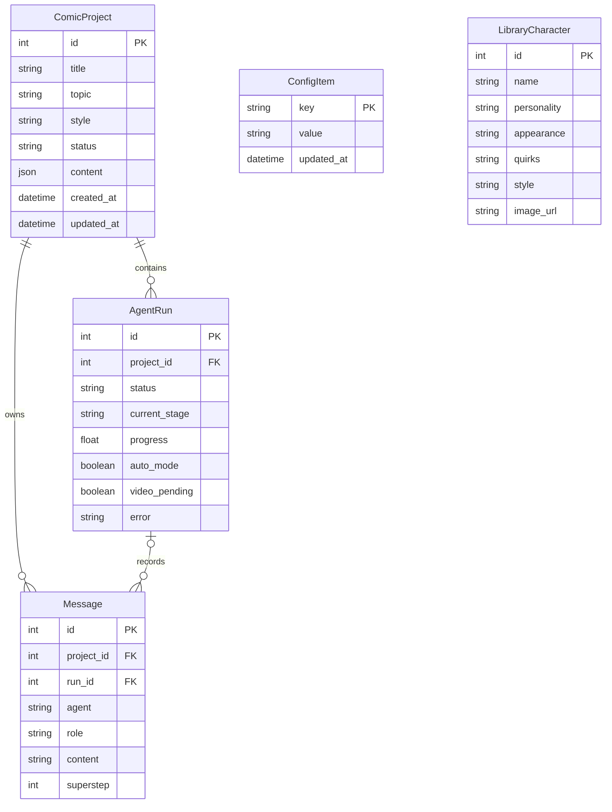

图中库角色与配置项是独立资源，没有声明“库角色必须属于某个项目”的数据库外键。项目中保留库角色 ID 与快照，不依赖级联更新。

同一个 SQLite 文件中还会包含 LangGraph 使用的 `checkpoints`、`checkpoint_blobs`、`checkpoint_writes` 等 checkpoint 表。`AgentRun.thread_id` 字段虽然存在于业务模型，当前 runner 实际按 run ID 计算线程标识，而不是依赖该列填充值。

### 16.2 项目 content 示例

这是结构示例，不代表每个阶段都已经有值；初始项目可能是空对象，回退中部分字段可能是 `None`。

```json
{
  "outline": {
    "title": "午夜车站",
    "logline": "青年在最后一班列车上寻找遗失的记忆。",
    "setting": "雨夜的城市",
    "tone": "温暖、悬疑",
    "acts": [{"title": "相遇", "plot": "一块停摆的怀表引出陌生乘客。"}]
  },
  "characters": [
    {"name": "林小满", "personality": "克制", "appearance": "黑发、灰色外套", "quirks": "转硬币"}
  ],
  "shots": [
    {
      "index": 1,
      "scene": "午夜站台",
      "camera": "缓慢推进",
      "action": "主角抬头看向到站列车",
      "dialogue": "这一次，我想起了你的名字。",
      "duration": 4.0,
      "character_ids": [0],
      "image_prompt": "本镜画面的生成提示词",
      "video_prompt": "本镜运动与气氛提示词"
    }
  ],
  "character_images": [
    {"character_name": "林小满", "url": "/static/images/example-character.png", "prompt": "角色立绘提示词"}
  ],
  "shot_images": [
    {"shot_index": 1, "url": "/static/images/example-shot.png", "prompt": "实际生效提示词", "stale": false}
  ],
  "reference_images": [
    {"id": "example-reference-id", "kind": "style", "target_index": null, "url": "/static/images/example-reference.png"}
  ],
  "cast": [],
  "video": {
    "url": "/static/videos/example-final.mp4",
    "voiceover_url": "/static/audio/example-voiceover.m4a",
    "notes": "合成说明"
  },
  "video_dirty": false
}
```

这里的 `example-*` 是说明性文件名，不是仓库实际附带媒体。

### 16.3 为什么 set_content 要替换整个字典

JSON 列的普通原地变更不一定被 SQLAlchemy 自动追踪：

```python
# 本项目使用整体替换，保证 commit 可以持久化：
updated = dict(project.content or {})
updated["shots"] = new_shots
project.content = updated
```

各业务路径调用 `ComicProject.set_content()` 处理该问题。新增内容编辑时，避免直接对嵌套 JSON 原地赋值后假设它一定写回数据库。

### 16.4 项目删除清理什么

删除接口持项目锁，若当前 run 存在本地后台 Task，先登记显式取消意图并等待收尾；随后删除：

- 项目行。
- 项目关联的所有 run 和消息。
- 对应 `agent-run-{id}` 的 checkpoint / blob / write 记录。
- 当前仍能从业务 content 收集到的立绘、分镜图、视频、配音与上传参考。
- 项目持有的 cast 图片副本。

角色库独立保存的图片不随着来源项目删除。已经被覆盖、回退清理引用或中途失败遗留的孤立媒体，当前没有全量资源索引与自动垃圾回收机制。

等待在途 Task 收尾的时限为 10 秒；超时会记录告警并继续清理。文件删除采取尽力处理，不把单个文件删除失败升级为整个项目删除失败。

### 16.5 本地时间

`china_now()` 使用 `Asia/Shanghai` 获取时间后去掉时区标记，业务表保存的是中国本地 naive 时间；这不是 UTC-aware 多时区系统。若增加跨时区用户，应统一改为明确的存储与展示时间策略。

<a id="api"></a>
## 17. HTTP API 与请求示例

### 17.1 接口清单

除健康检查外，下表路径统一加 `/api/v1` 前缀。最终请求 / 响应约束可直接打开运行实例的 `/docs` 或读取 `/openapi.json`。

| 方法 | 路径 | 功能 |
| --- | --- | --- |
| `GET` | `/health`（不加前缀） | 基础存活状态 |
| `POST` | `/projects` | 创建项目 |
| `GET` | `/projects` | 返回项目视图列表 |
| `GET` | `/projects/{id}` | 项目内容、最近 run、消息与动作 |
| `DELETE` | `/projects/{id}` | 停止在途任务并删除项目资源 |
| `POST` | `/projects/{id}/generate` | 新建 run；正常起步或定点重入 |
| `POST` | `/projects/{id}/confirm` | 确认当前 run 正等待的门 |
| `POST` | `/projects/{id}/resume` | 原 run 从 checkpoint 恢复 |
| `POST` | `/projects/{id}/cancel` | 显式停止当前运行 |
| `POST` | `/projects/{id}/references` | 原始图片上传；query 指定用途 |
| `DELETE` | `/projects/{id}/references/{reference_id}` | 移除项目参考图 |
| `PUT` | `/projects/{id}/shots/{shot_index}` | 保存分镜可编辑字段 |
| `POST` | `/projects/{id}/shots/{shot_index}/regenerate` | 独立单镜重画 |
| `GET` / `POST` | `/characters` | 读取 / 创建库角色 |
| `PUT` / `DELETE` | `/characters/{character_id}` | 编辑 / 删除库角色 |
| `POST` | `/characters/{character_id}/image` | 上传 / 替换库角色图片 |
| `POST` | `/projects/{id}/characters/{character_index}/library` | 项目角色存入库；角色下标从 0 起 |
| `POST` | `/projects/{id}/library-characters/{character_id}` | 库角色导入项目 |
| `GET` / `PUT` | `/config` | 掩码配置查询 / 保存与热更新 |

### 17.2 创建、生成和确认

以下为 Bash / Git Bash 示例，ID 仅用于展示，请替换为真实返回值。

```bash
# 创建项目：201，返回 id
curl -X POST http://127.0.0.1:18766/api/v1/projects \
  -H 'Content-Type: application/json' \
  -d '{"topic":"咖啡师与时间旅行者","style":"日系动漫"}'

# 启动人工模式
curl -X POST http://127.0.0.1:18766/api/v1/projects/1/generate \
  -H 'Content-Type: application/json' \
  -d '{"auto_mode":false}'

# 读取当前产物和 run；确认是否真的停在审批门
curl http://127.0.0.1:18766/api/v1/projects/1

# 通过当前门：空反馈
curl -X POST http://127.0.0.1:18766/api/v1/projects/1/confirm \
  -H 'Content-Type: application/json' \
  -d '{"run_id":1,"feedback":""}'

# 返工：仅在当前 run 确实等待某道门时提交
curl -X POST http://127.0.0.1:18766/api/v1/projects/1/confirm \
  -H 'Content-Type: application/json' \
  -d '{"run_id":1,"feedback":"第2镜的画面改为雨夜，保留其他镜头。"}'
```

上述“通过”和“返工”是两种选择，不是要求对同一次停留连续提交两次确认。`run_id` 必须来自 `/generate` 的响应，不能假定总等于项目 ID。

PowerShell 可使用 `Invoke-RestMethod` 避免 shell 引号差异：

```powershell
$base = 'http://127.0.0.1:18766/api/v1'
$body = @{ topic = '咖啡师与时间旅行者'; style = '日系动漫' } | ConvertTo-Json
$project = Invoke-RestMethod "$base/projects" -Method Post `
    -ContentType 'application/json; charset=utf-8' -Body ([Text.Encoding]::UTF8.GetBytes($body))
$run = Invoke-RestMethod "$base/projects/$($project.id)/generate" -Method Post `
    -ContentType 'application/json' -Body '{"auto_mode":false}'
$view = Invoke-RestMethod "$base/projects/$($project.id)"
```

### 17.3 自动模式、恢复与补成片

```bash
# 自动模式：每道门自动通过
curl -X POST http://127.0.0.1:18766/api/v1/projects/1/generate \
  -H 'Content-Type: application/json' -d '{"auto_mode":true}'

# 恢复：只有 interrupted 且存在 checkpoint 的原 run 可用
curl -X POST http://127.0.0.1:18766/api/v1/projects/1/resume

# 取消：放弃当前执行，和中断恢复是不同语义
curl -X POST http://127.0.0.1:18766/api/v1/projects/1/cancel

# 新建一轮补合成 run，复用现有画面
curl -X POST http://127.0.0.1:18766/api/v1/projects/1/generate \
  -H 'Content-Type: application/json' -d '{"start_stage":"compose"}'

# 重渲全部分镜图并继续后续图流程
curl -X POST http://127.0.0.1:18766/api/v1/projects/1/generate \
  -H 'Content-Type: application/json' -d '{"start_stage":"render_shots"}'
```

这些是独立动作示例，并非一段应不加判断地顺序执行的脚本。正常生成会检查文本 / 图像配置，即使选择定点入口也使用现有配置预检逻辑。

### 17.4 参考图与分镜编辑

```bash
# 整体风格参考：原始图片字节，不使用 -F multipart
curl -X POST 'http://127.0.0.1:18766/api/v1/projects/1/references?kind=style' \
  -H 'Content-Type: image/png' --data-binary '@reference.png'

# 指定第3镜
curl -X POST 'http://127.0.0.1:18766/api/v1/projects/1/references?kind=shot&target_index=3' \
  -H 'Content-Type: image/jpeg' --data-binary '@scene.jpg'

# 修改第1镜：假定项目已经存在角色0与分镜1
curl -X PUT http://127.0.0.1:18766/api/v1/projects/1/shots/1 \
  -H 'Content-Type: application/json' \
  -d '{"scene":"雨夜车站","camera":"缓慢推进","action":"主角回头","dialogue":"我记得你。","duration":5,"character_ids":[0],"image_prompt":"","video_prompt":""}'

# 只重画该镜
curl -X POST http://127.0.0.1:18766/api/v1/projects/1/shots/1/regenerate \
  -H 'Content-Type: application/json' -d '{"feedback":"雨滴更明显，保留人物构图"}'
```

### 17.5 角色库与配置

```bash
curl -X POST http://127.0.0.1:18766/api/v1/characters \
  -H 'Content-Type: application/json' \
  -d '{"name":"星野","appearance":"银色短发、蓝色眼睛","personality":"冷静好奇","quirks":"喜欢记录车站广播","style":"水彩童话"}'

curl -X POST http://127.0.0.1:18766/api/v1/characters/1/image \
  -H 'Content-Type: image/png' --data-binary '@character.png'

curl -X POST http://127.0.0.1:18766/api/v1/projects/1/library-characters/1

# 将项目内角色下标0保存为新的库角色
curl -X POST http://127.0.0.1:18766/api/v1/projects/1/characters/0/library

# 查看配置时，密钥字段不会明文返回
curl http://127.0.0.1:18766/api/v1/config

# 仅修改已有设置中的一个非敏感参数
curl -X PUT http://127.0.0.1:18766/api/v1/config \
  -H 'Content-Type: application/json' -d '{"values":{"video_max_shots":"3"}}'
```

保存项目角色为库角色会创建新记录，不自动覆盖已有同名库条目；向同一项目导入同名角色则返回冲突。

### 17.6 主要 HTTP 状态

| 状态 | 常见原因 |
| --- | --- |
| `200` | 查询、动作或更新成功 |
| `201` | 创建项目、创建库角色、保存角色或上传参考图成功 |
| `400` | 入口阶段非法、参考目标不正确、图片内容非法、配置字段非法 |
| `404` | 项目、run、角色、镜头或参考图不存在 |
| `409` | 同项目已有 run、未在当前门等待、编辑时机不对、图片 stale、角色同名冲突或配置不完整 |
| `413` | 上传超过 8 MiB |
| `422` | 请求未通过 Pydantic / FastAPI 结构校验 |
| `502` | 独立单镜重画的外部生成路径失败 |

发生 409 时先读取最新项目视图，不要把所有冲突都当成可以无限自动重试的网络错误。

<a id="frontend"></a>
## 18. 前端状态与交互设计

### 18.1 页面组织

```text
AppShell
  ├─ ThemeContext：主题状态与本机偏好
  ├─ 桌面侧栏 / 手机底部导航
  └─ HashRouter 页面
       ├─ HomePage：创意输入、风格选择、最近项目
       ├─ ProjectsPage：封面卡片、搜索、删除确认
       ├─ ProjectPage
       │    ├─ StageBar：六阶段、状态与生成动作
       │    ├─ StageBoard：大纲 / 角色 / 分镜 / 成片 / 参考图 / 角色库
       │    └─ ChatPanel：创作记录与当前审批操作
       ├─ CharactersPage：跨项目角色管理
       └─ SettingsPage：服务配置
```

### 18.2 前端如何知道按钮是否可以用

项目视图的 `actions` 包含：

```json
{
  "can_generate": false,
  "can_resume": false,
  "can_cancel": true,
  "waiting_gate": "shot_images_approval",
  "can_complete_video": false,
  "video_blocker": null,
  "can_edit_shots": true,
  "can_manage_cast": false,
  "can_manage_references": true,
  "edit_blocker": "请在对应审批阶段编辑；生成执行中请先等待或取消，已中断任务请先恢复。"
}
```

这里是结构示例，具体组合依当前阶段变化。前端大部分业务操作以这些后端动作字段为依据；HTTP 写入端仍会重新校验，UI 禁用本身不作为一致性保证。

### 18.3 轮询与旧响应保护

- 工作台每 2500 毫秒刷新项目视图。
- 项目列表每 5000 毫秒刷新。
- 动作结束后立即主动刷新一次，不等待下一个定时周期。
- `seq` 序号只允许最近请求更新状态，避免旧响应覆盖新内容。
- `busy` 在当前动作期间禁用冲突按钮。
- 当前不是 SSE / WebSocket token 流；生产长阶段内不展示逐 token 文本。

### 18.4 桌面与移动端

桌面以内容舞台为主，右侧显示可收起的创作记录。窄屏使用“内容舞台 / 创作记录”切换，避免把两者垂直挤在同一小视口；审批仍位于创作记录区。待确认状态和提示点帮助用户发现需要操作的阶段。

真实图片可以点击进入原生 dialog 大图预览，按 Escape 关闭，并下载本地媒体。明暗主题只在浏览器本机偏好中保存，不进入服务端业务配置或角色库。

<a id="testing"></a>
## 19. 测试与验证

### 19.1 后端测试

```bash
uv run --no-sync pytest -q

# 只验证创作编辑功能
uv run --no-sync pytest tests/test_creative.py -q

# 只验证图编排和断点续跑
uv run --no-sync pytest tests/test_orchestration.py tests/test_resume.py -q
```

本地验证基线：**164 passed，2 skipped**。这是当前代码在本地环境的测试结果，不是已经配置的 GitHub CI 状态或真实外部服务可用性承诺。测试数量会随代码变化。

| 测试领域 | 代表文件 | 覆盖内容 |
| --- | --- | --- |
| 内容生产 | `test_agents.py`、`test_llm.py` | JSON 契约、上下文、模型响应与失败分支 |
| 媒体接线 | `test_media.py`、`test_agents_media.py` | 请求字段、参考图、下载、视频任务和 fake / real 适配 |
| 图编排 | `test_orchestration.py`、`test_state.py` | 主线、阶段映射、review 路由 |
| Critic / review | `test_critique.py`、`test_critic_review.py` | 评分、降级、白名单和轮数上限 |
| API 生命周期 | `test_api.py`、`test_gateway.py` | 六门推进、重复生成、过期确认、取消、删除 |
| 恢复 | `test_resume.py` | 清扫 interrupted、checkpoint 恢复与已完成阶段复用 |
| 视频与语音 | `test_video_pending.py`、`test_video_merger.py`、`test_tts.py` | 补片、拼接降级、音轨长度和失败不阻塞 |
| 创作编辑 | `test_creative.py` | 上传、单镜重画、图失效、库角色副本、失败保留旧产物与重画 / 确认并发 |
| 配置与错误 | `test_config.py`、`test_errors.py` | 持久化、热更新、非法配置不落库、用户文案 |

测试使用独立 `.test-comic.db`，在导入应用前处理 provider / 环境种子，并通过 fake、monkeypatch 或 `httpx.MockTransport` 避免真实付费 API 调用。依赖本机 FFmpeg 的用例在缺少程序时跳过。

注意：测试库文件名固定，不要把两个 pytest 进程同时指向同一份 checkout 的测试库运行。若需要并行测试，应先给每个 worker / 进程分配独立数据库。

### 19.2 浏览器交互回归

已有脚本：

- [test_creative_ui.mjs](scripts/test_creative_ui.mjs)：新建库角色、上传形象、导入项目、保存参考图、编辑分镜、单镜重画与其他镜头保持不变。
- [test_studio_ui.mjs](scripts/test_studio_ui.mjs)：明暗主题与偏好保存、记录侧栏、大图预览、项目搜索、桌面 / 平板 / 手机宽度及六道人工审批。

脚本会真实创建测试数据，使用独立端口和**首次初始化为 fake 的独立数据库**。下面是 PowerShell 示例；不要把浏览器回归指向日常使用的真实项目库。

终端一：

```powershell
New-Item -ItemType Directory -Path .venv-preview -Force | Out-Null
$env:DATABASE_URL = 'sqlite+aiosqlite:///.venv-preview/docs-ui.db'
$env:TEXT_PROVIDER = 'fake'
$env:IMAGE_PROVIDER = 'fake'
$env:VIDEO_PROVIDER = 'fake'
$env:TTS_ENABLED = 'false'
uv run --no-sync uvicorn app.main:app --host 127.0.0.1 --port 18767
```

终端二，仍在根目录：

```powershell
# 将浏览器测试依赖放在忽略的本地工具目录
npm install --prefix .venv-preview/browser-tools --no-package-lock playwright
node .venv-preview/browser-tools/node_modules/playwright/cli.js install chromium

# 创建一张有效 PNG 作为上传夹具，不影响真实素材
uv run --no-sync python -c "from PIL import Image; Image.new('RGB',(320,240),'#657d78').save('.venv-preview/ui-reference.png')"

$env:PLAYWRIGHT_MODULE = Join-Path (Get-Location) '.venv-preview/browser-tools/node_modules/playwright/index.mjs'
$env:BASE_URL = 'http://127.0.0.1:18767'
node scripts/test_creative_ui.mjs
node scripts/test_studio_ui.mjs
```

已安装本机 Chrome 的环境也可通过 `CHROME_PATH` 指定可执行文件。截图和报告分别保存在 `.venv-preview/ui-results`、`.venv-preview/ui-redesign`。第二个脚本会读取第一个脚本生成的演示项目报告，所以按上述顺序执行。

### 19.3 基准脚本

```bash
uv run --no-sync python scripts/bench.py

# 保留基准数据库用于分析
uv run --no-sync python scripts/bench.py --keep
```

脚本使用独立端口 `18777`、独立 `.bench.db` 和 fake 服务，涉及全流程、消息去重、人工门推进、并发保护、定向回炉和进程中断后的恢复。运行结果以实际输出为准；README 不把 fake 基准耗时当成真实模型推理速度。

### 19.4 文档自检与流程图导出

```bash
uv run --no-sync python scripts/check_readme.py
```

自检覆盖本地文件链接、25 个目录锚点、代码围栏、JSON 示例、33 个 Settings 字段和 15 个图阶段是否被记录。

流程图以 README 的 Mermaid 代码为唯一维护来源；`scripts/check_readme_mermaid.mjs` 使用浏览器中的 Mermaid 11 解析和渲染，并导出 `docs/diagrams/*.svg`。在已经准备好上文浏览器工具与 `PLAYWRIGHT_MODULE` 的环境中：

```bash
npm install --prefix .venv-preview/docs-tools --no-package-lock --no-audit --no-fund mermaid@11
node scripts/check_readme_mermaid.mjs
```

本地渲染与截图报告在 `.venv-preview/docs-check`。这些是文档验证工具，不是运行创作应用必须安装的前端依赖。

<a id="deployment"></a>
## 20. Docker 部署与数据备份

### 20.1 单容器构建

```bash
# 仅首次准备本地配置；已有 .env 时保留
test -f .env || cp .env.example .env
docker compose up --build -d

docker compose logs -f comic-agent
```

Dockerfile 分为两段：

1. Node.js 22 构建前端 `dist`。
2. Python 3.13 安装 FFmpeg 与锁定后端依赖，拷入应用和前端产物，启动单个 Uvicorn 进程。

镜像默认监听容器内 `0.0.0.0:18766`；Compose 默认映射宿主机 `18766` 端口。部署前按实际访问范围决定是否只绑定本机，当前应用没有账户认证和项目访问隔离。

### 20.2 挂载与持久化

| 宿主机 | 容器内 | 内容 |
| --- | --- | --- |
| `./data/db` | `/app/data` | 业务库、配置、角色库与 checkpoint |
| `./data/static` | `/app/app/static` | 图片、视频、音频 |
| 根目录 `.env` | 通过 `env_file` 注入 | 启动参数，不复制进应用镜像 |

Compose 把 DB URL 设为：

```text
sqlite+aiosqlite:////app/data/comic-agent.db
```

因此容器升级、镜像重建与前端重构不会自动清空宿主机数据。库文件备份包含配置中的敏感值；媒体文件不在 SQLite 中，需要一起备份。

### 20.3 可选构建镜像源

```powershell
$env:DEBIAN_MIRROR = 'mirrors.aliyun.com'
$env:PYPI_INDEX = 'https://pypi.tuna.tsinghua.edu.cn/simple'
docker compose up --build -d
```

这些是 Docker 构建参数，不是模型服务配置。是否需要切换源，取决于构建机器的网络条件。

### 20.4 备份策略

简单且一致的本地备份方式：先停止写入，再备份整份 `data` 和单独保管的 `.env`，完成后启动。

```bash
docker compose stop
# 使用自己的备份工具复制 data/db 与 data/static
docker compose start
```

运行中的 SQLite 可能使用 WAL / SHM 辅助文件。不要在持续写入时只随手复制主 `.db` 文件，然后假设这一定是完整一致快照；可使用 SQLite backup API 或停写后复制。

恢复也需要同时考虑 DB 中的媒体 URL 与对应文件。仅恢复数据库会出现“记录还在、图片不存在”的情况。

### 20.5 为什么不直接多 worker

当前以下数据都在进程内：

- `gateway` 的 `asyncio.Event` 和确认状态。
- `_tasks` 的后台任务注册表。
- `_locks` 的项目互斥锁。
- 热更新 Settings 单例。

两个 worker 可能分别接到生成与确认请求，导致确认找不到等待事件；两份项目锁也不会互相排斥。因此不要简单加 `--workers 4` 来宣称已实现横向扩容。

分布式版本至少需要：共享任务台账 / worker 归属、确认与取消消息路由、跨进程并发约束、配置广播、适配的 checkpoint 存储和共享媒体存储。Redis pub/sub 可以解决一部分信号问题，但仅替换网关不足以完成整个系统的多实例化。

<a id="development"></a>
## 21. 目录结构与二次开发

### 21.1 目录结构

```text
comic-agent-main/
├─ app/
│  ├─ main.py                         # FastAPI 工厂、生命周期、静态资源
│  ├─ config.py                       # Settings 默认值与运行单例
│  ├─ runner.py                       # 单次 run、checkpointer、状态收尾
│  ├─ gateway.py                      # 人工确认的进程内信号状态机
│  ├─ errors.py                       # 已知错误的用户文案
│  ├─ agents.py                       # 分阶段生产、代理评分与反馈分诊
│  ├─ api/
│  │  ├─ projects.py                  # 项目生命周期、锁、任务注册
│  │  ├─ creative.py                  # 素材、分镜、单镜重画、角色库
│  │  └─ config.py                    # 配置查询 / 保存
│  ├─ db/
│  │  ├─ session.py                   # 异步会话、建表、列迁移、启动清扫
│  │  └─ utils.py                     # 中国本地时间
│  ├─ models/
│  │  ├─ project.py                   # ComicProject 和 content 操作
│  │  ├─ agent_run.py                 # AgentRun
│  │  ├─ message.py                   # Message 与 superstep
│  │  ├─ config_item.py               # ConfigItem
│  │  └─ library_character.py         # LibraryCharacter
│  ├─ orchestration/
│  │  ├─ graph.py                     # 15 节点与所有条件边
│  │  ├─ nodes.py                     # 生产、审批、critic、review
│  │  ├─ state.py                     # RunState、阶段锚点与进度
│  │  ├─ driver.py                    # ainvoke / interrupt / Command 循环
│  │  └─ persistence.py               # SQLite checkpointer
│  ├─ prompts/
│  │  ├─ outline.py                   # 大纲契约
│  │  ├─ characters.py                # 角色契约
│  │  ├─ shots.py                     # 分镜与媒体提示词契约
│  │  ├─ image_prompts.py             # 视觉风格、构图和兜底 prompt
│  │  ├─ review.py                    # 回退分诊契约
│  │  └─ critic.py                    # 代理评分标准
│  ├─ services/
│  │  ├─ project_view.py              # 面向 UI 的项目读模型与动作
│  │  ├─ creative.py                  # 上传验证、编辑权限、图片复制
│  │  ├─ config_service.py            # 种子、回灌、掩码与热更新
│  │  ├─ llm.py                       # Chat Completions 与 JSON 解析
│  │  ├─ media.py                     # 图片适配、Ark 任务、素材存取
│  │  ├─ tts.py                       # 语音合成
│  │  └─ video_merger.py              # FFmpeg、音轨与时长探测
│  └─ static/                         # 运行媒体，默认不入 Git
├─ frontend/
│  ├─ src/
│  │  ├─ main.tsx                     # 路由与 AppShell 装配
│  │  ├─ api.ts                       # 请求与错误类型
│  │  ├─ types.ts                     # 后端响应类型和阶段标签
│  │  ├─ components/
│  │  │  ├─ AppShell.tsx              # 导航与主题
│  │  │  ├─ TopBar.tsx                # 面包屑与主题切换
│  │  │  ├─ StageBar.tsx              # 六阶段状态栏
│  │  │  ├─ StageBoard.tsx            # 内容分区、画面与大图预览
│  │  │  ├─ ChatPanel.tsx             # 创作记录与审批
│  │  │  ├─ CreativePanels.tsx        # 素材、角色库与分镜编辑
│  │  │  └─ Icon.tsx                  # 统一的 SVG 图标
│  │  ├─ hooks/useProjectPolling.ts   # 轮询、动作和旧响应保护
│  │  ├─ pages/                      # 首页、项目、工作台、角色库、设置
│  │  └─ styles/index.css            # 主题变量、布局与响应式
│  ├─ public/studio-mark.svg          # 站点标记
│  ├─ vite.config.ts                 # 开发端口与 API 代理
│  └─ package-lock.json              # 前端锁文件
├─ tests/                            # 后端单元与集成测试
├─ scripts/
│  ├─ bench.py                       # 独立 fake 服务基准
│  ├─ test_creative_ui.mjs            # 创作功能浏览器回归
│  ├─ test_studio_ui.mjs              # 主题、布局与审批浏览器回归
│  ├─ check_readme.py                 # 文档链接、示例与配置覆盖检查
│  └─ check_readme_mermaid.mjs         # Mermaid 解析、渲染与 SVG 导出
├─ docs/assets/                      # README 界面截图
├─ docs/diagrams/                    # 从 README 图定义导出的 SVG
├─ .env.example                      # 可提交的配置模板
├─ .env                              # 本机配置，不提交
├─ pyproject.toml
├─ uv.lock
├─ Dockerfile
├─ docker-compose.yml
└─ README.md
```

### 21.2 增加新的生产阶段

新增阶段通常需要同步修改以下位置：

1. `state.py`：阶段词表、生产顺序、审批 / critic 锚点。
2. `graph.py`：注册节点并添加合法边。
3. `nodes.py`：producer 注册、门配置、依赖清理顺序、回退白名单。
4. `agents.py` / `prompts/`：输入上下文、输出 schema、归一化和 fake 实现。
5. `runner.py` / API：如果增加定点入口，同步调整入口白名单和初始状态。
6. 前端 `types.ts`、`StageBar`、`StageBoard`：阶段标签和内容展示。
7. 测试：正常推进、返工范围、checkpoint 恢复和 stale 数据边界。

不要只加一个图节点而忽略清理矩阵与进度锚点，否则界面、回退和恢复会对同一阶段产生不同理解。

### 21.3 增加模型服务商

优先在 `services` 中适配厂商协议，而不是在图中加入某个 API 的字段：

```text
Settings 新字段 / provider
    → 配置 API 白名单与校验
    → 服务客户端 / 工厂分支
    → producer 接线
    → 前端设置入口
    → MockTransport 契约测试
    → 小范围真实账号联调
```

同样叫“OpenAI 兼容”也不意味着图像编辑、多图输入、推理开关、TTS 或视频任务协议完全兼容。

### 21.4 更细的增量重建与版本管理

当前线性清理可以进一步扩展为：

- 为大纲、角色、镜头、立绘、分镜图分别建立资产 ID 与版本号。
- 保存依赖关系，例如“镜头 3 的画面使用角色版本 2”。
- 根据字段变化精确计算失效范围。
- 保存编辑历史与选中的候选版本。
- 将昂贵媒体任务拆成独立、可恢复的 asset job。

这样能把“回退到某一阶段后重跑下游”逐步演进为“只更新实际受影响的资产”。这些属于扩展方向，当前代码没有把它们作为已实现能力。

<a id="faq"></a>
## 22. 常见问题

### Q1：启动后只有 `/docs`，首页 404？

先在 `frontend` 执行 `npm ci && npm run build`，再启动或重启后端。前端路径在 `create_app()` 初始化时挂载；没有 `dist` 时跳过。

### Q2：为什么生成后只看到占位画面和不可播放的预览？

当前 provider 是 `fake`。它用于演示流程，不产生真实图片或可播放 MP4。到服务设置启用真实图像 / 视频 provider 并完成配置后，重新生成相应产物。

### Q3：改了 `.env`，设置页仍显示旧模型？

同一数据库已经初始化过运营配置。启动后 DB 值会回灌覆盖相应设置；使用设置页 / 配置 API 更新。不要为了改模型直接删除有作品的数据库。

### Q4：明明页面显示确认阶段，`confirm` 却返回 409？

可能刚离开上一门、网关还未进入等待、已有另一条裁决，或 stale 画面还没更新。读取最新项目视图并等待真实可操作时机；检查 409 的具体文案。

### Q5：提交修改意见后，好像没有改到想改的地方？

检查 review 实际路由和反馈是否明确点名：画面问题写“第3镜的画面……”，脚本问题写“第3镜的台词……”，角色立绘问题明确角色名。规则、模型输出和当前门白名单共同决定目标。fake 模板主要验证流程，不保证理解任意修改意图。

### Q6：为什么改分镜脚本后立绘也重新生成？

图内 review 使用 `_STAGE_FIELD_ORDER` 的保守线性清理，`plan_shots` 之后包含 `character_images`。明确只修改一镜脚本时，可以使用独立编辑，再重画对应镜头，避免用大范围回退解决局部问题。

### Q7：重启之后怎么继续？取消之后也能继续吗？

重启遗留任务会被标为 `interrupted`，有 checkpoint 时可恢复原 run；明确取消是 `cancelled`，当前 API 不提供相同续跑语义。首次 checkpoint 尚未建立的中断任务需要新开一轮。

### Q8：上传参考图以后，旧画面为什么没变？

上传只保存素材。它会用于下一次对应生产或单镜重画，不会自动改写已有画面。真实参考输入还需要配置一致性编辑模型。

### Q9：单镜重画失败，会丢掉原来的图片吗？

在生成成功并提交业务结果之前，不覆盖原有 `shot_images`。接口失败时保留旧产物；但外部请求可能已经产生资源，失败 / 超时并不代表厂商一定没有接受任务或计费。

### Q10：成片为什么显示待补生成？

检查视频服务密钥 / 模型、分镜图是否为真实本地文件，以及是否存在未更新的 stale 镜头。前置条件未满足会 `video_pending`，真正调用后失败则看 run 错误。FFmpeg / ffprobe 缺失也会影响真实合成。

### Q11：脚本里写了 4 秒，实际视频不一定 4 秒？

脚本时长和模型请求时长是两层信息。视频客户端使用 `VIDEO_DURATION` 等服务配置；配音优先读取真实片段长度对齐，而不是假定脚本值等于最终 MP4 时长。

### Q12：只改连接串就能换 PostgreSQL 吗？

不能。当前 `open_checkpointer()` 只处理 SQLite，非 SQLite URL 会报错；还需要数据库驱动、对应 checkpointer、迁移与并发验证。业务 ORM 的可移植性不等于整套持久化已经可直接切换。

### Q13：可以直接多 worker、多人在线使用吗？

当前设计是单进程、无用户隔离的本地工作室。多 worker 会遇到确认信号、任务归属、项目锁和配置一致性问题；团队版本还需要认证授权与资源归属模型。

### Q14：依赖安装后出现原生模块不存在或时间字段报错？

优先按 `uv.lock` 在当前机器重建环境，确认 Python 版本与扩展模块匹配。不要把某台机器的 `.venv` 或任意更新后的数据库依赖当成项目锁定环境；升级后运行回归再判断兼容性。

<a id="limitations"></a>
## 23. 当前能力与限制

这些边界用于区分已实现功能与后续扩展，不应从截图或流程图推断不存在的能力。

| 方面 | 当前边界 |
| --- | --- |
| 质检 | 描述 / prompt 的文本代理评分，没有真实图片视觉检查 |
| 质量上限 | 达到 critic 轮数上限后仍可进入人工审批，不承诺所有画面达标 |
| 一致性 | 参考图 + 文本锚定，有数量和模型能力限制，不保证跨镜完全一致 |
| 修改粒度 | 普通大纲 / 角色文本主要靠提示词约束；没有通用字段级补丁系统 |
| 回退语义 | 业务内容失效后重建，不是恢复某个历史作品版本，也不是数据库事务回滚 |
| 独立重画 | 同步 HTTP 路径，不自动走图内 critic，也没有独立 job checkpoint |
| 外部幂等 | 没有对付费 API 建立严格 exactly-once 保证 |
| 远程任务 | Ark task ID 没有单独持久台账，进程中断可能需要重新提交 |
| 资源清理 | 删除当前引用资源，不保证自动回收所有历史孤立媒体 |
| 视频 | 按镜头请求与拼接，不是完整非线性剪辑器 |
| 音频 | 逐镜台词合成与时间轴铺设；无唇形同步、多角色音色映射或自动台词压缩 |
| 数据 | 本地 SQLite 与本地媒体；没有内置对象存储、正式迁移框架或多租户隔离 |
| 运行 | 内存信号和 Task 注册；当前要求单进程 |
| 权限 | 无用户认证、角色权限、项目所有权验证 |
| 配置 | 热更新全局设置；没有每个 run 的不可变配置快照 |
| 错误与密钥 | 配置响应掩码，但本地库未应用层加密，未知错误仍可能暴露调试内容 |
| 性能指标 | fake 基准不等于真实模型吞吐；当前 README 没有宣称生产 SLA |

可继续演进的方向包括真正的多模态 critic、资产依赖图、版本历史、持久媒体 job、异步单镜队列、任务级配置快照、共享信号和任务调度、对象存储、认证与团队协作。

<a id="github"></a>
## 24. GitHub 发布说明

### 24.1 建议随仓库提交的内容

- 后端和前端源代码、测试、脚本。
- `pyproject.toml`、`uv.lock`、`frontend/package.json`、`frontend/package-lock.json`。
- `.env.example`，只保留占位示例与默认 fake 设置。
- `Dockerfile`、`docker-compose.yml`、忽略配置。
- 本 README 与 `docs/assets` 中专门用于文档的截图。

不应把本地运行目录当成项目源码：`.venv` / `.venv-preview`、`node_modules`、`dist`、运行 `.env`、业务 / 测试 DB、WAL / SHM 和 `app/static` 都是本地配置、构建产物或用户数据。当前 `.gitignore` 已包含对应常见规则；文档截图刻意放在 `docs/assets`，不会依赖忽略的 `.venv-preview` 路径。

### 24.2 在本地查看将提交的内容

仓库初始化后，可先检查：

```bash
git status --short
git check-ignore .env .venv .venv-preview frontend/node_modules comic-agent.db
git ls-files .env '*.db' '*.db-wal' '*.db-shm' 'app/static/*'
```

`.gitignore` 不会自动清除已经跟踪的文件或历史中的内容，因此不能只凭“有忽略文件”就判断待上传内容已经合适。

### 24.3 首次推送示例

以下仅提供操作模板，仓库地址需要替换为作者自己的目标地址：

```bash
git init
git branch -M main

# 检查忽略规则与待提交内容后再暂存
git add .
git diff --cached --stat
git status --short

git commit -m "docs: document Comic Studio architecture and workflows"
git remote add origin https://github.com/YOUR_USER/YOUR_REPOSITORY.git
git push -u origin main
```

如果已有 Git 仓库 / remote，先查看 `git remote -v`，不要重复添加同名 remote。README 不虚构项目作者、远程地址、Stars、CI 通过状态或已经发布的版本。

### 24.4 README 中的图和许可

本文使用 `mermaid` fenced code blocks，GitHub Markdown 可直接渲染；不需要把流程图截图后再维护一份不可编辑图片。有关支持方式见 [GitHub Creating diagrams](https://docs.github.com/en/get-started/writing-on-github/working-with-advanced-formatting/creating-diagrams)。

也附带已经渲染的 SVG，便于单独打开、放大或用于演示：

| 图 | SVG |
| --- | --- |
| 系统架构 | [architecture.svg](docs/diagrams/architecture.svg) |
| LangGraph 完整执行图 | [execution-graph.svg](docs/diagrams/execution-graph.svg) |
| 人工审批时序 | [approval-sequence.svg](docs/diagrams/approval-sequence.svg) |
| 反馈回退分诊 | [rollback.svg](docs/diagrams/rollback.svg) |
| 两组 critic 闭环 | [critic.svg](docs/diagrams/critic.svg) |
| 编辑与产物失效 | [editing.svg](docs/diagrams/editing.svg) |
| Run 状态机 | [run-state.svg](docs/diagrams/run-state.svg) |
| 视频与配音链路 | [media-pipeline.svg](docs/diagrams/media-pipeline.svg) |
| 数据模型 | [data-model.svg](docs/diagrams/data-model.svg) |

当前目录未附带 `LICENSE` 文件。本 README 不替作者指定许可证，也不添加不存在的许可证徽章；正式发布时可由作者补充选择的许可文件。

<a id="references"></a>
## 25. 技术参考

### 框架概念

- [LangGraph Interrupts](https://docs.langchain.com/oss/python/langgraph/interrupts)：动态中断、恢复值与副作用幂等。
- [LangGraph Persistence](https://docs.langchain.com/oss/python/langgraph/persistence)：checkpointer、thread 与持久状态。
- [uv Installation](https://docs.astral.sh/uv/getting-started/installation/)：安装依赖管理工具。
- [GitHub Creating diagrams](https://docs.github.com/en/get-started/writing-on-github/working-with-advanced-formatting/creating-diagrams)：Markdown 中的 Mermaid 图。
- [Mermaid Documentation](https://mermaid.js.org/intro/)：可编辑流程图、时序图、状态图与 ER 图语法。

### 建议的源码阅读顺序

```text
理解系统入口：
  app/main.py → api/projects.py → runner.py

理解图如何推进：
  orchestration/graph.py → state.py → nodes.py → driver.py

理解人工介入和回退：
  gateway.py → nodes._approve → nodes.review_node → agents.decide_review_target

理解实际内容生产：
  agents.py → prompts/ → services/llm.py、media.py、tts.py、video_merger.py

理解编辑、素材和 UI：
  api/creative.py → services/creative.py → services/project_view.py
  → frontend/src/api.ts → useProjectPolling.ts → ProjectPage / CreativePanels

确认行为边界：
  tests/ → scripts/test_creative_ui.mjs → scripts/test_studio_ui.mjs
```

文档描述以仓库当前实现为准；框架通用概念、未来扩展方向和真实服务商能力，不应替代具体代码路径与联调结果。
